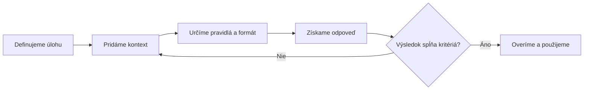

# 🧠 Prompt Engineering – Promptovacie techniky a frameworky

Praktická príručka pre **ChatGPT, Google Gemini a ďalšie veľké jazykové modely (LLM)**. Vysvetľujeme, ako formulovať zadania, pridávať správny kontext, určiť pravidlá, vybrať formát výstupu a postupne overovať výsledky.

Dokument je určený pre zamestnancov, lektorov, marketérov, manažérov, programátorov, študentov a doktorandov. Príklady sú pripravené na **kopírovanie priamo do chatu** a na ďalšie vlastné úpravy.

> **Základné pravidlo:** Kvalitný prompt nemusí byť dlhý. Má obsahovať informácie a požiadavky, ktoré AI potrebuje na splnenie konkrétnej úlohy. Ani podrobný prompt nezaručuje vecnú správnosť výsledku.

**Podklad:** prezentácia *Promptovacie Techniky Engi.pdf* (23 strán, november 2026). Kapitoly o definícii promptu, siedmich komponentoch, ukážkach zadaní, GIGO, zmene jazyka a knižniciach promptov vychádzajú z prezentácie. **Kapitoly o ôsmich technikách a štyroch frameworkoch sú doplneným praktickým rozšírením** podľa tém školenia; ich detailný výklad nie je súčasťou priloženého 23-stranového PDF.

## 📚 Obsah

1. [Čo je Prompt Engineering](#co-je-prompt-engineering)
2. [Sedem komponentov kvalitného promptu](#sedem-komponentov-kvalitneho-promptu)
3. [Nekvalitné vs. kvalitnejšie zadanie a GIGO](#nekvalitne-vs-kvalitnejsie-zadanie-a-gigo)
4. [Osem promptovacích techník](#osem-promptovacich-technik)
5. [Typy obmedzení v promptoch](#typy-obmedzeni-v-promptoch)
6. [Formáty výstupov](#formaty-vystupov)
7. [Frameworky RTF, RISEN, CREATE a CRISPE](#frameworky-rtf-risen-create-a-crispe)
8. [Prompt chaining v praxi](#prompt-chaining-v-praxi)
9. [Prompt Engineering pre PhD a výskum](#prompt-engineering-pre-phd-a-vyskum)
10. [Jazyk rozhrania a odpovedí AI](#jazyk-rozhrania-a-odpovedi-ai)
11. [Knižnice promptov a rozšírenia](#kniznice-promptov-a-rozsirenia)
12. [Cvičenia, kontrolný zoznam a zdroje](#cvicenia-kontrolny-zoznam-a-zdroje)

<a id="co-je-prompt-engineering"></a>
## 📌 1. Čo je Prompt Engineering

**Prompt** je zadanie alebo súbor inštrukcií, ktoré poskytneme modelu AI. Môže obsahovať text, pracovné údaje, priložené dokumenty, vzorové príklady a požadovanú podobu výstupu.

**Prompt engineering** je proces navrhovania, testovania a zlepšovania promptov s cieľom získať relevantnejšie, presnejšie a konzistentnejšie výsledky. Nestačí „pridať viac slov“ – dôležitá je kvalita informácií a kontrola výsledku.

### Základný pracovný postup



**Vysvetlenie:** Prompt obyčajne priebežne upravujeme. Iterácia nie je chyba; patrí k metóde práce s AI.

<a id="sedem-komponentov-kvalitneho-promptu"></a>
## 🧩 2. Sedem komponentov kvalitného promptu

| Komponent | Čo definujeme | Príklad |
|---|---|---|
| **1. Rola (Role)** | Z akej odbornej perspektívy má AI odpovedať | „Vystupuj ako projektový koordinátor.“ |
| **2. Úloha alebo cieľ (Task / Goal)** | Čo má AI urobiť a aký výsledok potrebujeme | „Zostav plán dokončenia projektu.“ |
| **3. Kontext (Context)** | Vstupné údaje, okolnosti, cieľová skupina, prílohy | „Máme 3 zamestnancov a 7 dní.“ |
| **4. Obmedzenia (Constraints)** | Čo musí dodržať alebo nesmie tvrdiť | „Nevymýšľaj chýbajúce termíny.“ |
| **5. Formát (Format)** | Podobu a štruktúru výstupu | „Tabuľka: Úloha, Vlastník, Termín.“ |
| **6. Príklady (Examples)** | Vzor požadovaného štýlu, postupu alebo výsledku | „Vstup → Očakávaný výstup.“ |
| **7. Overenie (Verification)** | Ako skontrolujeme kvalitu a správnosť | „Skontroluj súčty a časové kolízie.“ |

> **Dôležité:** Ide o užitočné komponenty, nie o povinných sedem položiek každého promptu. Rola a príklady sú voliteľné; pri jednoduchých úlohách často stačí jasná úloha a formát.

### Univerzálna šablóna

```text
Rola: [V akej role má AI vystupovať]
Úloha a cieľ: [Čo konkrétne chceme dosiahnuť]
Kontext: [Relevantné informácie, vstupy, prílohy]
Obmedzenia: [Pravidlá, rozsah, zakázané domnienky]
Formát: [Tabuľka, zoznam, dokument, JSON...]
Príklad: [Voliteľná ukážka požadovaného výsledku]
Overenie: [Podľa čoho výsledok skontrolujeme]
```

<a id="nekvalitne-vs-kvalitnejsie-zadanie-a-gigo"></a>
## ⚖️ 3. Nekvalitné vs. kvalitnejšie zadanie a GIGO

### Príklad A – Plánovanie pracovného dňa

**Menej presné, ale realistické zadanie:**

```text
Naplánuj mi zajtrajší pracovný deň. Musím vybaviť e-maily,
dokončiť report, pripraviť prezentáciu a zúčastniť sa porady.
Potrebujem rozumné poradie úloh a prestávky, aby som stihol
najdôležitejšie povinnosti.
```

**Problém:** Nie sú uvedené presné termíny, pracovný čas ani odhadovaná náročnosť jednotlivých úloh.

**Kvalitnejšie zadanie:**

```text
Rola: Vystupuj ako asistent pracovnej produktivity.
Úloha: Naplánuj môj zajtrajší pracovný deň.

Kontext: Pracujem od 9:00 do 17:00. Poradu mám od 11:00
do 12:00. Prezentácia potrebuje 90 minút, report 2 hodiny
a e-maily približne 30 minút.

Obmedzenia: Prezentáciu musím dokončiť do 15:00. Zaraď
30-minútový obed a krátke prestávky. Úlohy sa nesmú prekrývať.

Formát: Tabuľka Čas | Aktivita | Priorita.
Overenie: Skontroluj časové kolízie, termín prezentácie
a reálnosť harmonogramu. Ak niečo nestíham, jasne to označ.
```

**Očakávaný rozdiel:** AI nemusí hádať trvanie práce ani pevné termíny. Aj tak skontrolujeme, či navrhnutý harmonogram zodpovedá skutočnosti.

### Príklad B – Zhrnutie interného dokumentu

**Menej presné zadanie:**

```text
Zhrň priložený dokument. Vyber hlavné informácie a vysvetli,
na čo si majú zamestnanci dať pozor.
```

**Kvalitnejšie zadanie:**

```text
Vystupuj ako analytik pracovných dokumentov.
Analyzuj priložený dokument o zmenách interných postupov.
Zhrnutie použijeme na informovanie zamestnancov.

Vytvor tabuľku: Téma | Zmena | Praktický dopad | Termín
| Strana dokumentu.

Používaj iba informácie z prílohy. Ak údaj chýba, uveď
„V dokumente neuvedené“. Nevymýšľaj právne závery.
Pri dôležitých tvrdeniach uveď číslo strany.
```

**Pozor:** Príloha musí byť skutočne dostupná v konverzácii. Označenie stránky overíme vo vstupnom PDF.

### Garbage In, Garbage Out (GIGO)

**GIGO** znamená „nekvalitný vstup → nekvalitný výstup“. Pri AI ide o praktické upozornenie, že neúplné, rozporné alebo nepravdivé podklady môžu viesť k nesprávnemu výsledku.

| Problém vstupu | Možný dôsledok | Prevencia |
|---|---|---|
| Chýbajúce dátumy a rozsah | Neuskutočniteľný harmonogram | Uviesť termíny alebo označiť neznáme |
| Neoverené čísla | Zavádzajúca analýza | Overiť zdrojové dáta |
| Nejasná cieľová skupina | Príliš všeobecný text | Spresniť publikum a účel |
| Protikladné požiadavky | Nekonzistentná odpoveď | Stanoviť priority |
| Chýbajúca príloha | Domýšľanie jej obsahu | Súbor priložiť a preveriť |

<a id="osem-promptovacich-technik"></a>
## 🧪 4. Osem promptovacích techník

Nasledujúce techniky sú rozšírením pôvodných podkladov o praktické školenie. Nie sú vzájomne vylučujúce – v jednom prompte môžeme kombinovať rolu, kontext, príklady, obmedzenia aj formát.

| Technika | Princíp | Typické použitie |
|---|---|---|
| **Zero-shot** | Bez vzorových príkladov | Priame pracovné zadania |
| **One-shot** | Jeden vzorový príklad | Napodobnenie podoby odpovede |
| **Few-shot** | Viacero vzorových príkladov | Jednotný štýl, kategorizácia |
| **Role prompting** | Určenie odbornej perspektívy | Konzultácie a vysvetlenia |
| **Contextual prompting** | Doplnenie relevantných informácií | Analýza dokumentov a situácií |
| **Constraint-based prompting** | Stanovenie pravidiel a hraníc | Firemné texty a citlivé dáta |
| **Output-format prompting** | Požiadavka na konkrétny formát | Tabuľky, JSON, CSV, PDF |
| **Prompt chaining** | Viacero nadväzujúcich promptov | Viackrokové projekty a kontrola |

### 4.1 Zero-shot, One-shot a Few-shot – tá istá pracovná úloha

**Úloha vo všetkých troch variantoch:** Upraviť neformálnu pracovnú správu. Meníme iba počet vzorových príkladov.

**Zero-shot – bez vzoru:**

```text
Prepíš text profesionálne, stručne a zdvorilo.
Zachovaj význam a nevymýšľaj nový termín.

Text: „Ahoj, ten report ešte nemám, chýbajú mi čísla
od kolegov. Keď ich dostanem, dokončím ho.
Zatiaľ neviem, kedy to bude.“
```

**One-shot – jeden vzor:**

```text
Prepíš text profesionálne, stručne a zdvorilo.
Zachovaj význam a nevymýšľaj nový termín.

Vzor:
Vstup: „Ahoj, dnes to nestihnem, pošlem zajtra.“
Výstup: „Podklady dnes nestihnem dokončiť.
Zašlem vám ich zajtra.“

Teraz uprav:
„Ahoj, ten report ešte nemám, chýbajú mi čísla
od kolegov. Keď ich dostanem, dokončím ho.
Zatiaľ neviem, kedy to bude.“
```

**Few-shot – tri vzory:**

```text
Prepíš text profesionálne, stručne a zdvorilo.
Zachovaj význam a nevymýšľaj nový termín.

Vstup: „Ahoj, dnes to nestihnem, pošlem zajtra.“
Výstup: „Podklady dnes nestihnem dokončiť.
Zašlem vám ich zajtra.“

Vstup: „Čau, pozrel si ten súbor? Potrebujem vedieť, či je OK.“
Výstup: „Prosím o potvrdenie, či ste už dokument
skontrolovali a či je v poriadku.“

Vstup: „Zatiaľ nemáme všetky podklady, ozvem sa.“
Výstup: „Zatiaľ nemáme všetky potrebné podklady.
Po ich doplnení vás budem informovať.“

Teraz uprav:
„Ahoj, ten report ešte nemám, chýbajú mi čísla
od kolegov. Keď ich dostanem, dokončím ho.
Zatiaľ neviem, kedy to bude.“
```

**Overenie:** Všetky tri výstupy môžu byť správne. Few-shot nie je automaticky presnejší; vzory najmä pomáhajú usmerniť konzistentnosť štýlu a formátu.

### 4.2 Role prompting – odborná perspektíva

Porovnáme dve roly pri **rovnakej úlohe**:

```text
Variant A:
Vystupuj ako HR manažér.
Vysvetli vedeniu malej firmy, ako zaviesť
nové pravidlá práce z domu.

Variant B:
Vystupuj ako špecialista internej komunikácie.
Vysvetli vedeniu malej firmy, ako zaviesť
nové pravidlá práce z domu.
```

**Pozorovanie:** HR manažér môže zdôrazniť personálne pravidlá, komunikačný špecialista spôsob oznámenia. Priradená rola **nezaručuje odbornú správnosť**.

### 4.3 Contextual prompting – viac relevantných údajov

```text
Priprav odpoveď zákazníkovi.
Objednal si kancelársku stoličku za 250 €.
Dodanie mešká štyri dni. Dopravca oznámil,
že zásielku očakáva najneskôr v piatok.
Zákazník žiada vysvetlenie a nápravu.
```

**Kontext:** Cena, typ produktu, omeškanie, informácia od dopravcu a požiadavka zákazníka.

### 4.4 Constraint-based prompting – pravidlá a hranice

```text
Odpoveď zákazníkovi napíš v maximálne 120 slovách.
Použi zdvorilý tón. Uveď termín oznámený dopravcom,
ale neprezentuj ho ako garantovaný.
Nesľubuj finančnú kompenzáciu ani skoršie doručenie.
```

**Obmedzenia:** Rozsah, štýl, presnosť tvrdení a zakázané neopodstatnené sľuby.

### 4.5 Output-format prompting – forma výsledku

```text
Z nasledujúcich pracovných poznámok vytvor Markdown tabuľku
so stĺpcami Úloha | Zodpovedný | Termín | Stav.

Poznámky: Jana pripraví cenovú ponuku do piatka.
Peter preverí dodávateľov. Web musíme aktualizovať
pred pondelkovou kampaňou.

Ak osoba, termín alebo stav nie sú uvedené,
napíš „Neurčené“. Nevymýšľaj chýbajúce údaje.
```

### 4.6 Prompt chaining – nadväzujúce kroky

Pri reťazení **výstup jedného promptu vstupuje do ďalšieho**. Úplný príklad nájdeme v [kapitole 8](#prompt-chaining-v-praxi).

<a id="typy-obmedzeni-v-promptoch"></a>
## 🛡️ 5. Typy obmedzení v promptoch

Nasledujúce kategórie sú **praktická didaktická klasifikácia**, nie univerzálna technická norma. Niektoré pravidlá môžu patriť do viacerých kategórií súčasne.

| Typ obmedzenia | Na čo slúži | Príklad formulácie |
|---|---|---|
| **Rozsahové** | Dĺžka a veľkosť výstupu | „Maximálne 150 slov, presne 5 bodov.“ |
| **Obsahové** | Povinné alebo vylúčené témy | „Sústreď sa na pracovné dôsledky.“ |
| **Štylistické** | Jazyk, tón a čitateľnosť | „Píš formálne a zrozumiteľne.“ |
| **Formátové** | Štruktúra výsledku | „Použi tabuľku so 4 stĺpcami.“ |
| **Faktické** | Prevencia nepodložených tvrdení | „Nevymýšľaj citácie ani čísla.“ |
| **Procesné** | Poradie vykonávaných úkonov | „Najprv analyzuj, potom odporuč.“ |
| **Časové** | Obdobie a termíny | „Plán priprav na 5 pracovných dní.“ |
| **Zdrojové** | Povolené informačné zdroje | „Pracuj výlučne s priloženým PDF.“ |
| **Technické** | Kompatibilita a technické hranice | „Použi Python 3.13 bez externých knižníc.“ |
| **Kvalitatívne** | Kritériá kvality výsledku | „Odstráň duplicity a skontroluj rozpory.“ |

**Vysvetlenie:** Obmedzenia usmerňujú odpoveď, ale nezaručujú ich bezchybné dodržanie. Presný počet slov, platnosť JSON či matematické výpočty preveríme aj nezávisle.

<a id="formaty-vystupov"></a>
## 📤 6. Formáty výstupov

| Formát alebo typ výstupu | Praktické využitie | Poznámka |
|---|---|---|
| **TXT** | E-maily, poznámky, správy | Čistý text |
| **Markdown (MD)** | README, dokumentácia, návody | Formátovaný text |
| **Markdown tabuľka** | Porovnanie údajov a možností | Forma zobrazenia |
| **HTML** | Web, WordPress, e-maily | Kód stránky alebo bloku |
| **JSON** | API, aplikácie, automatizácie | Vyžaduje validáciu |
| **CSV** | Import do Excelu a systémov | Treba určiť oddeľovač a kódovanie |
| **TSV** | Kopírovanie tabuľkových údajov | Tabulátory medzi hodnotami |
| **XML** | Výmena údajov medzi systémami | Validácia podľa potreby |
| **YAML** | Konfiguračné súbory | Citlivý na odsadenie |
| **SQL** | Databázové dopyty | Pred spustením skontrolovať |
| **Python / JavaScript** | Skripty a automatizácie | Otestovať vo vhodnom prostredí |
| **Mermaid** | Vývojové a procesné diagramy | Renderuje sa v GitHube |
| **SVG** | Ikony a vektorová grafika | Vektorový obrázok |
| **LaTeX** | Matematika a vedecké publikácie | Sadzba vzorcov |
| **PDF** | Reporty a materiály na tlač | Reálny súbor len s príslušnou funkciou |
| **DOCX** | Smernice, pracovné dokumenty | Reálny súbor len s príslušnou funkciou |
| **XLSX** | Rozpočty, výpočty, grafy | Reálny súbor len s príslušnou funkciou |
| **PPTX** | Školenia a prezentácie | Reálny súbor len s príslušnou funkciou |
| **PNG / JPG** | Ilustrácie a grafika | Vyžaduje podporu obrazového výstupu |

**Rozlišujeme:** (1) text, ktorý iba opisuje formát, (2) kód alebo dáta v požadovanom formáte a (3) skutočný stiahnuteľný súbor. ChatGPT a Gemini nemusia mať v každom režime rovnaké nástroje a exportné možnosti.

### Príklad – výstup JSON

**Prompt:**

```text
Vytvor validný JSON s údajmi o objednávke.
Číslo: 2026-001. Produkt: kancelárska stolička.
Cena: 250 EUR. Počet kusov: 2.
Použi polia cislo, produkt, cena_eur, pocet_kusov.
Vráť iba objekt JSON bez Markdownu a komentárov.
```

**Očakávaný tvar:**

```json
{
  "cislo": "2026-001",
  "produkt": "kancelárska stolička",
  "cena_eur": 250,
  "pocet_kusov": 2
}
```

### Príklad – CSV na import do Excelu

```text
Vytvor CSV tabuľku troch úloh.
Stĺpce: Úloha;Zodpovedný;Termín.
Použi bodkočiarku ako oddeľovač, UTF-8
a nevkladaj vysvetlenie pred ani za CSV.
```

**Očakávaný tvar:**

```csv
Úloha;Zodpovedný;Termín
Cenová ponuka;Jana;Piatok
Kontrola rozpočtu;Peter;Neurčené
Aktualizácia webu;Neurčené;Pondelok
```

### Príklad – skutočný PDF report

```text
Vytvor dvojstranový PDF report obchodného oddelenia
za október 2026. Použi tieto údaje:

Tržby september: 41 000 €
Tržby október: 45 000 €
Plán október: 40 000 €
Objednávky september: 110
Objednávky október: 125

Strana 1: názov, KPI, stĺpcový graf tržieb.
Strana 2: porovnávacia tabuľka, tri zistenia,
päť odporúčaní na ďalší mesiac.

Vypočítaj rast tržieb, plnenie plánu
a priemernú hodnotu októbrovej objednávky.
Nevymýšľaj príčiny zmien.
Vytvor skutočný PDF súbor na stiahnutie,
skontroluj výpočty a presne dve strany.
```

**Kontrolné hodnoty:** rast tržieb **9,76 %**, plnenie plánu **112,5 %**, priemerná hodnota objednávky **360 €**.

<a id="frameworky-rtf-risen-create-a-crispe"></a>
## 🧱 7. Frameworky RTF, RISEN, CREATE a CRISPE

Framework je **opakovateľná štruktúra promptu**, ktorá pomáha usporiadať viacero požiadaviek. Tieto skratky predstavujú neformálne metodické vzory; nie sú univerzálne štandardy ani garancia lepšej odpovede.

| Framework | Komponenty | Silná stránka | Praktické použitie |
|---|---|---|---|
| **RTF** | Role, Task, Format | Rýchle zadanie | E-maily, FAQ, vysvetlenia |
| **RISEN** | Role, Instructions, Steps, End Goal, Narrowing | Postup, cieľ a hranice | Analýzy, audity, projekty |
| **CREATE** | Character, Request, Examples, Adjustments, Type of Output, Extras | Vzory a úprava štýlu | Copywriting, marketing, komunikácia |
| **CRISPE** | Capacity & Role, Insight, Statement, Personality, Experiment | Alternatívy a porovnanie | Výskum, konzultácie, rozhodovanie |

### 7.1 RTF – Role, Task, Format

```text
R – Role:
Vystupuj ako asistent firemnej komunikácie.

T – Task:
Napíš e-mail dodávateľovi, ktorý mešká päť dní
s cenovou ponukou. Potrebujeme ju do piatka
na dokončenie výberu dodávateľa.

F – Format:
Priprav predmet, oslovenie, hlavný text a záver.
Maximálne 120 slov. Píš profesionálne po slovensky.
```

**Použitie:** Rýchla pracovná komunikácia s jednoznačným výstupom.

### 7.2 RISEN – Role, Instructions, Steps, End Goal, Narrowing

```text
R – Role:
Vystupuj ako projektový manažér.

I – Instructions:
Naša firma má o 7 dní odovzdať zákazníkovi nový web.
Nedokončené sú produktové stránky, test objednávkového
formulára a korektúry. Na projekte pracujú 3 zamestnanci.
Navrhni plán dokončenia.

S – Steps:
1. Identifikuj kritické úlohy a závislosti.
2. Urči priority.
3. Rozdeľ prácu medzi roly.
4. Zostav sedemdňový harmonogram.
5. Pomenuj hlavné riziká.

E – End Goal:
Priprav akčný plán s úlohami, termínmi, prioritami
a zodpovednými rolami.

N – Narrowing:
Nevymýšľaj mená ani prácnosť ako overené údaje.
Odhady označ ako predpoklady a zohľadni kapacitu tímu.
```

**Použitie:** Pri úlohách, kde je dôležitý nielen výsledok, ale aj spôsob spracovania.

### 7.3 CREATE – Character, Request, Examples, Adjustments, Type of Output, Extras

```text
C – Character:
Vystupuj ako skúsený reklamný copywriter.

R – Request:
Naša firma uvádza na trh výškovo nastaviteľný
ergonomický kancelársky stôl. Napíš texty pre ľudí,
ktorí pracujú v kancelárii alebo z domu.

E – Examples:
Vzor tónu: „Striedajte prácu v sede a v stoji.
Prispôsobte pracovné miesto svojmu dňu.“

A – Adjustments:
Píš prirodzene, bez zdravotných garancií,
vymyslených parametrov a marketingových klišé.

T – Type of Output:
Vytvor 2 varianty krátkeho textu pre e-shop.

E – Extras:
Ku každému pridaj nadpis a výzvu na nákup (CTA).
```

**Použitie:** Keď chceme cielene riadiť vzor, tón, štruktúru a doplnkové prvky textu.

### 7.4 CRISPE – Capacity & Role, Insight, Statement, Personality, Experiment

```text
C – Capacity & Role:
Vystupuj ako metodológ pedagogického výskumu
so znalosťami experimentálnych dizajnov a štatistiky.

I – Insight:
Pripravujem doktorandský výskum o využívaní
generatívnej AI vo vzdelávaní dospelých.
Chcem merať výsledky testovania a schopnosť
samostatne aplikovať poznatky.

S – Statement:
Navrhni výskumné otázky, testovateľné hypotézy,
premenné, zber údajov a metodiku analýzy.

P – Personality:
Píš akademicky, vecne, vysvetľuj odborné pojmy
a rozlišuj predpoklady od overených zistení.

E – Experiment:
Porovnaj 3 alternatívne výskumné dizajny:
randomizovaný experiment, kváziexperiment
a zmiešaný výskum. Uveď výhody, obmedzenia,
riziká skreslenia a náročnosť realizácie.
```

**Použitie:** Pri porovnávaní rôznych možností. „Experiment“ v tomto frameworku neznamená, že AI reálne vykonala vedecký experiment.

### Ktorý framework zvoliť

**RTF** pri rýchlej komunikácii; **RISEN** pri krokoch a obmedzeniach; **CREATE** pri textoch podľa vzoru; **CRISPE** pri porovnávaní alternatív. Framework zvolíme podľa **charakteru úlohy**, nie počtu jeho komponentov. Rovnakú úlohu možno spracovať viacerými frameworkmi.

<a id="prompt-chaining-v-praxi"></a>
## 🔗 8. Prompt chaining v praxi

Zložitejšiu úlohu rozdelíme na **viacero nadväzujúcich promptov**. Každý ďalší krok vychádza z výsledku predchádzajúceho. Medzi krokmi výsledky kontrolujeme a v prípade chyby sa vraciame späť.

### Príklad – od čísel po manažérsky report

**Krok 1 – Analýza dát:**

```text
Analyzuj výsledky oddelenia.
September: tržby 41 000 €, objednávky 110.
Október: tržby 45 000 €, objednávky 125.
Plán októbra: 40 000 €.

Vypočítaj rast tržieb, rast objednávok,
plnenie plánu a hodnotu objednávky.
Výsledky zobraz v tabuľke a skontroluj výpočty.
```

**Krok 2 – Interpretácia:**

```text
Na základe predchádzajúcej tabuľky urč
3 hlavné zistenia. Oddeľ údaje od hypotéz.
Nevymýšľaj príčiny rastu tržieb.
```

**Krok 3 – Odporúčania:**

```text
Z predchádzajúcich zistení navrhni 5 opatrení
na november. Ku každému priraď KPI na meranie
účinku. Odhady neprezentuj ako potvrdené výsledky.
```

**Krok 4 – Odovzdanie výsledku:**

```text
Z predchádzajúcich výstupov vytvor dvojstranový
PDF report pre vedenie. Pridaj KPI, graf tržieb,
tabuľku, zistenia a odporúčania.
Pred odovzdaním skontroluj údaje a počet strán.
```

**Poznámka:** V rámci jedného chatu môžeme nadväzovať na predchádzajúce odpovede, ale pri veľmi dlhých konverzáciách nemusí byť celý starší kontext dostupný. V novej konverzácii potrebné výstupy podľa potreby priložíme alebo zopakujeme.

<a id="prompt-engineering-pre-phd-a-vyskum"></a>
## 🎓 9. Prompt Engineering pre PhD a výskum

AI môže pomôcť s **návrhom** výskumného dizajnu, rešeršného protokolu, analytického kódu alebo kontrolného zoznamu. Bez skutočných podkladov však nesmie predstierať, že už vykonala empirickú analýzu.

### Príklad A – Návrh dizertačného výskumu

```text
Vystupuj ako metodológ vedeckého výskumu.
Skúmam vplyv používania generatívnej AI
na výsledky vzdelávania dospelých.

Navrhni hlavný cieľ, 3 až 5 parciálnych cieľov,
výskumné otázky, testovateľné hypotézy
a operacionalizáciu premenných.

Porovnaj randomizovaný experiment,
kváziexperiment a zmiešaný dizajn.
Pri každom zhodnoť validitu, riziká skreslenia,
etiku a realizovateľnosť.

Nepredstieraj, že existujú výsledky výskumu.
Nevymýšľaj publikácie ani DOI.
```

### Príklad B – Systematická rešerš

```text
Vystupuj ako metodológ systematických prehľadov.
Téma: generatívna AI vo vysokoškolskom vzdelávaní
v rokoch 2022–2026.

Navrhni výskumné otázky, kritériá zaradenia
a vyradenia, vyhľadávacie reťazce pre Scopus,
Web of Science a ERIC, extrakčnú tabuľku
a postup hodnotenia kvality štúdií.

Oddeľ návrh rešeršnej stratégie od skutočne
vykonaného vyhľadávania. Nevymýšľaj počet nájdených
štúdií, autorov, výsledky ani DOI.
```

### Príklad C – Štatistická analýza priloženého CSV

```text
Vystupuj ako štatistik.
Prikladám anonymizované párové údaje
zo vstupného a výstupného testovania.

Najprv skontroluj chýbajúce hodnoty,
duplicitné identifikátory a párovanie.
Potom posúď predpoklady párového t-testu,
Wilcoxonovho párového testu a vhodnej
robustnej alternatívy.

Vyber metodologicky primeraný postup,
vykonaj výpočty nad skutočnými dátami,
uveď efektové miery, neistotu a obmedzenia.
Pridaj reprodukovateľný kód.
Nevymýšľaj hodnoty p ani veľkosť vzorky.
```

**Princíp:** AI je asistent výskumníka, nie náhrada vedeckej kontroly, etického posúdenia, recenzovania a replikácie.

<a id="jazyk-rozhrania-a-odpovedi-ai"></a>
## 🌍 10. Jazyk rozhrania a odpovedí AI

Pre školenie rozlišujeme **jazyk používateľského rozhrania** a **jazyk samotnej odpovede**. Prompt „Odpovedaj po slovensky“ mení požiadavku na odpoveď, nie nevyhnutne nastavenie celej aplikácie.

| Služba | Odporúčaný spôsob zmeny jazyka rozhrania | Poznámka |
|---|---|---|
| **ChatGPT** | Profil → Settings / Nastavenia → General / Všeobecné → Language / Jazyk | Oficiálne dokumentovaný postup |
| **Gemini web** | Preferovaný jazyk prehliadača alebo zariadenia | Podľa oficiálnej pomoci Google |
| **Gemini mobilná aplikácia** | Nastavenia aplikácie → Jazyky, ak je vo verzii dostupné | Možnosti sa líšia podľa platformy |
| **Claude** | Jazykové nastavenie v aplikácii, ak je dostupné | Rozhranie sa môže meniť |

### URL varianty z prezentácie

V pôvodnom PDF sú uvedené aj príklady adresy **Gemini s parametrom `hl`**:

```text
https://gemini.google.com/app?hl=en
https://gemini.google.com/app?hl=sk
https://gemini.google.com/app?hl=cs
```

Pre **ChatGPT** prezentácia uvádza napríklad:

```text
https://chatgpt.com/cs-CZ/
https://chatgpt.com/?locale=cs-CZ
https://chatgpt.com/sk-SK/
https://chatgpt.com/?locale=sk
```

**Dôležité upozornenie:** Toto sú URL príklady uvedené na snímkach PDF, nie zdokumentované garancie stabilného prepnutia rozhrania. Parametre sa môžu ignorovať, presmerovať alebo prestať fungovať. Pri návode odporúčame **oficiálne jazykové nastavenia**, nie spoliehanie sa na konkrétny URL parameter.

Oficiálne zdroje: [Nastavenie jazyka ChatGPT](https://help.openai.com/en/articles/8357869-how-to-change-your-language-setting-in-chatgpt) a [Zmena jazyka Gemini](https://support.google.com/gemini/answer/15984485).

<a id="kniznice-promptov-a-rozsirenia"></a>
## 🗂️ 11. Knižnice promptov a rozšírenia

Prezentácia uvádza ukážky online galérií promptov a rozšírení pre prehliadač. Slúžia na hľadanie vzorov, ich úpravu a ukladanie vlastných zadaní.

| Zdroj | Využitie | Poznámka |
|---|---|---|
| [Ray.so Prompts](https://ray.so/prompts/) | Verejná galéria promptov | Vzor treba prispôsobiť vlastnej úlohe |
| [Google Gemini – Prompt design strategies](https://ai.google.dev/gemini-api/docs/prompting-strategies) | Oficiálne techniky a príklady | Dokumentácia pre Gemini API |
| [OpenAI – Prompt engineering](https://help.openai.com/en/articles/10032626) | Zásady dobrého promptu | Oficiálny zdroj |
| [Anthropic – Prompting best practices](https://platform.claude.com/docs/en/build-with-claude/prompt-engineering/claude-prompting-best-practices) | Príklady, role, formát a reťazenie | Oficiálna dokumentácia Claude |

Na snímkach prezentácie sú aj ukážky **Superpower for Gemini**, **Workbench for ChatGPT**, **Superpower for Claude** a ďalších galérií. Tieto rozšírenia sú od **tretích strán**; ich oprávnenia, dostupnosť a zásady spracovania dát pred použitím preveríme.

**Bezpečnosť:** Do verejných knižníc ani neoverených rozšírení nevkladáme heslá, API kľúče, citlivé firemné dokumenty či osobné údaje bez príslušného oprávnenia.

<a id="cvicenia-kontrolny-zoznam-a-zdroje"></a>
## ✅ 12. Cvičenia, kontrolný zoznam a zdroje

### Praktické cvičenia

| Cvičenie | Zadanie | Čo porovnávame |
|---|---|---|
| **1. Slabší vs. lepší prompt** | Naplánujeme pracovný deň s kontextom a bez kontextu | Reálnosť harmonogramu |
| **2. 0 / 1 / 3 vzory** | Upravíme pracovnú správu | Konzistentnosť tónu a formátu |
| **3. Rola** | Tú istú úlohu zadáme dvom rolám | Rozdiely perspektívy |
| **4. Kontext a obmedzenia** | Odpovieme na omeškanú objednávku | Dôslednosť vo faktoch |
| **5. Formát** | Z poznámok vytvoríme tabuľku a CSV | Použiteľnosť výsledku |
| **6. RTF** | Napíšeme profesionálny pracovný e-mail | Rola, úloha, formát |
| **7. RISEN** | Naplánujeme dokončenie meškajúceho projektu | Kroky, cieľ, hranice |
| **8. CREATE** | Pripravíme reklamný text podľa vzoru | Štýl a varianty |
| **9. CRISPE** | Porovnáme tri výskumné dizajny | Alternatívne riešenia |
| **10. Prompt chaining** | Z dát vytvoríme zistenia, odporúčania a report | Nadväznosť a kontrola |

### Kontrolný zoznam pred použitím výsledku

- [ ] Zadanie obsahuje jasnú úlohu a cieľ.
- [ ] Vstupné údaje sú úplné a primerane overené.
- [ ] Cieľová skupina a prípadná rola dávajú zmysel.
- [ ] Neprotirečia si pravidlá a obmedzenia.
- [ ] Je určený požadovaný formát výstupu.
- [ ] Príklady neobsahujú chybné alebo skresľujúce vzory.
- [ ] Chýbajúce informácie sú označené, nie vymyslené.
- [ ] Čísla, dátumy, citácie a odkazy sme nezávisle skontrolovali.
- [ ] Pri dlhom reťazci sme skontrolovali priebežné kroky.
- [ ] Citlivé údaje zdieľame iba v schválenom prostredí.

### Užitočné zdroje

- **Primárny kurzový podklad:** *Promptovacie Techniky Engi.pdf*, 23 strán. Definície a komponenty: s. 9–10; porovnanie zadaní: s. 11–12; jazykové tipy: s. 3–7; knižnice promptov: s. 13–22; zdroje: s. 23.
- [OpenAI – Prompt engineering best practices for ChatGPT](https://help.openai.com/en/articles/10032626)
- [Google – Prompt design strategies for Gemini](https://ai.google.dev/gemini-api/docs/prompting-strategies)
- [Anthropic – Prompting best practices](https://platform.claude.com/docs/en/build-with-claude/prompt-engineering/claude-prompting-best-practices)
- [OpenAI – How to change your language setting in ChatGPT](https://help.openai.com/en/articles/8357869-how-to-change-your-language-setting-in-chatgpt)
- [Google – Change Gemini's language](https://support.google.com/gemini/answer/15984485)

