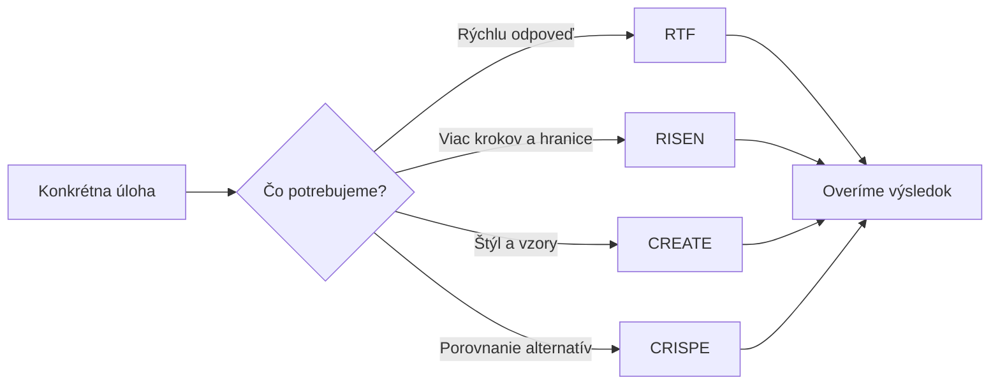
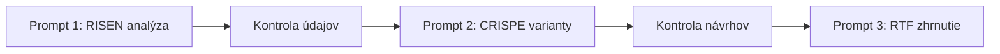

# 🧭 Promptovacie frameworky – RTF, RISEN, CREATE a CRISPE

Praktický študijný materiál na tvorbu kvalitných promptov v **ChatGPT, Google Gemini a ďalších AI nástrojoch**. Vysvetľujeme štyri opakovateľné štruktúry zadania a ukazujeme ich využitie v každodennej práci, obchode, HR, marketingu, manažmente aj vo vedeckom výskume.

> **Základný princíp:** Dobre napísaný jednoduchý prompt môže byť účinnejší než rozsiahla šablóna. Framework vyberáme podľa charakteru úlohy a požadovaného spôsobu spracovania, nie podľa počtu jeho komponentov alebo zložitosti.

## 📚 Obsah

1. [Definícia a prehľad frameworkov](#prehlad)
2. [RTF – Role, Task, Format](#rtf)
3. [RISEN – Role, Instructions, Steps, End Goal, Narrowing](#risen)
4. [CREATE – Character, Request, Examples, Adjustments, Type, Extras](#create)
5. [CRISPE – Capacity & Role, Insight, Statement, Personality, Experiment](#crispe)
6. [Porovnanie a výber frameworku](#porovnanie)
7. [Framework verzus prompt chaining](#chaining)
8. [ChatGPT Projects a Gemini Gems / Skills](#projekty)
9. [Opakovateľné šablóny promptov](#sablony)
10. [Praktické cvičenia](#cvicenia)
11. [Kontrola kvality a časté chyby](#kontrola)
12. [Odborné zdroje a ďalšie materiály](#zdroje)

<a id="prehlad"></a>
## 📌 1. Definícia a prehľad promptovacích frameworkov

**Framework (rámec)** je opakovateľná štruktúra promptu spájajúca viacero prvkov zadania: rolu, úlohu, kontext, postup, pravidlá a výstup. Pomáha nám vytvárať konzistentné, zrozumiteľné prompty. **RTF, RISEN, CREATE a CRISPE sú komunitné alebo metodické vzory, nie univerzálne technické štandardy** (PDF, s. 2).

| Framework | Anglický rozpis | Charakter úlohy | Náročnosť* |
|---|---|---|---|
| **RTF** | Role, Task, Format | Stručné pracovné zadania a definovaný výstup | Nízka |
| **RISEN** | Role, Instructions, Steps, End Goal, Narrowing | Analýzy, postupy a kontrolné hranice | Stredná |
| **CREATE** | Character, Request, Examples, Adjustments, Type of Output, Extras | Špecifický štýl obsahu, vzory a varianty | Stredná |
| **CRISPE** | Capacity & Role, Insight, Statement, Personality, Experiment | Odborné varianty, výskum a rozhodovanie | Stredná až vyššia |

\* Náročnosť je orientačným pedagogickým hodnotením zostavenia promptu, nie objektívnym meraním jeho účinnosti.

**Čo všetky rámce spája:** Úloha musí mať jasný cieľ a dostatočné vstupy. Rámce možno kombinovať a nemusíme vždy vyplniť všetky ich komponenty do samostatných riadkov.

### Výber rámca podľa cieľa (metodické doplnenie)



<a id="rtf"></a>
## 🟢 2. RTF – Role, Task, Format

RTF predstavuje **najjednoduchší z vybraných frameworkov** (PDF, s. 3). Používame ho na e-maily, tabuľky, vysvetlenia, prepisy, FAQ, pracovné postupy a jednoduché návrhy.

| Komponent | Slovenský význam | Čo určujeme |
|---|---|---|
| **R – Role** | Rola | Z akej odbornej perspektívy má AI odpovedať |
| **T – Task** | Úloha | Čo konkrétne chceme vykonať |
| **F – Format** | Formát | Ako má vyzerať výsledok, rozsah a tón |

### Základná ukážka – e-mail o oneskorení objednávky (PDF, s. 3)

```text
R – Role:
Skúsený asistent firemnej komunikácie.

T – Task:
Napíš e-mail zákazníkovi, ktorým ho informujeme,
že jeho objednávka bude doručená o 3 dni neskôr,
než bolo plánované.

F – Format:
Priprav predmet e-mailu, oslovenie, hlavný text a záver.
Maximálne 120 slov, profesionálny a empatický tón,
po slovensky.
```

**Kontrola:** Zadanie neobsahuje presné dátumy doručenia ani príčinu meškania; nemáme ich domýšľať.

### Ďalšie pracovné príklady RTF (PDF, s. 4–8)

### Analýza údajov v Exceli

*Podklad: prezentácia, s. 4.*

```text
R – Role (Rola)
Vystupuj ako dátový analytik so skúsenosťami s Microsoft Excelom.

T – Task (Úloha)
Analyzuj priloženú Excel tabuľku s predajmi za posledných 12 mesiacov. Identifikuj 5
najpredávanejších produktov podľa tržieb, mesiace s najvyššími a najnižšími predajmi a
hlavné trendy.

F – Format (Formát)
Priprav prehľad KPI, tabuľku TOP 5 produktov, stĺpcový graf mesačných tržieb a 5 odporúčaní
pre obchodné oddelenie. Výsledky uvádzaj v eurách a percentách.
```

**Kontrola výstupu (metodické doplnenie):** Bez priloženého Excel súboru nemožno vypočítať TOP 5 produktov ani tržby.

### Tvorba marketingového príspevku na sociálne siete

*Podklad: prezentácia, s. 5.*

```text
R – Role (Rola)
Vystupuj ako skúsený marketingový copywriter.

T – Task (Úloha)
Priprav reklamný príspevok na Facebook pre novootvorenú kaviareň v centre Bratislavy.
Kaviareň ponúka výberovú kávu, domáce koláče a raňajkové menu. Cieľom je prilákať nových
zákazníkov počas pracovných dní.

F – Format (Formát)
Vytvor 3 varianty príspevku, každý maximálne 100 slov. Použi pútavý úvod, hlavné výhody,
primerané emoji a výzvu na návštevu. Každý variant musí mať odlišný komunikačný štýl.
```

**Kontrola výstupu (metodické doplnenie):** Model nemá podklady o otváracích hodinách ani zľavách; tieto údaje nesmie domýšľať.

### Vytvorenie pracovného postupu

*Podklad: prezentácia, s. 6.*

```text
R – Role (Rola)
Vystupuj ako konzultant pre optimalizáciu firemných procesov.

T – Task (Úloha)
Navrhni jednoduchý postup spracovania zákazníckych objednávok v malej firme. Proces zahŕňa
prijatie objednávky, kontrolu platby, prípravu tovaru, odoslanie zásielky a informovanie
zákazníka.

F – Format (Formát)
Priprav číslovaný postup krok za krokom, tabuľku zodpovedností a procesný diagram vo
formáte Mermaid. Na konci uveď 3 rizikové miesta procesu.
```

**Kontrola výstupu (metodické doplnenie):** Proces a zodpovednosti sú návrhom, nie popisom existujúcej internej smernice.

### Príprava pracovného pohovoru

*Podklad: prezentácia, s. 7.*

```text
R – Role (Rola)
Vystupuj ako HR špecialista so skúsenosťami s náborom zamestnancov.

T – Task (Úloha)
Priprav otázky na pracovný pohovor pre pozíciu administratívneho pracovníka. Uchádzač bude
zabezpečovať komunikáciu so zákazníkmi, evidenciu faktúr, správu dokumentov a organizovanie
stretnutí.

F – Format (Formát)
Vytvor 10 otázok rozdelených do kategórií Odborné zručnosti, Komunikácia a Riešenie
problémov. Ku každej otázke doplň, čo ňou chceme overiť. Pridaj 2 praktické zadania.
```

**Kontrola výstupu (metodické doplnenie):** Otázky majú hodnotiť pracovné kompetencie, nie osobné alebo diskriminačné charakteristiky.

### Spracovanie zápisu z pracovnej porady

*Podklad: prezentácia, s. 8.*

```text
R – Role (Rola)
Vystupuj ako projektový koordinátor.

T – Task (Úloha)
Spracuj tieto poznámky z porady: „Jana pripraví cenovú ponuku do piatka. Peter musí
preveriť dodávateľov. Web potrebujeme aktualizovať pred pondelkovým spustením kampane.
Martin zabezpečí reklamné podklady do štvrtka.“

F – Format (Formát)
Vytvor tabuľku so stĺpcami Úloha, Zodpovedná osoba, Termín a Stav. Pri chýbajúcich údajoch
uveď „Neurčené“. Na záver pridaj stručný súhrn najbližších termínov.
```

**Kontrola výstupu (metodické doplnenie):** Pri Petrovi nie je daný termín; pri aktualizácii webu nie je určená zodpovedná osoba.


<a id="risen"></a>
## 🟠 3. RISEN – Role, Instructions, Steps, End Goal, Narrowing

RISEN zdôrazňuje **postup spracovania, výsledný cieľ a hranice zadania**. V prezentácii je ilustrovaný auditmi, nákupom, HR, marketingom a procesným riadením (PDF, s. 9–13).

| Komponent | Slovenský význam | Praktická otázka |
|---|---|---|
| **R – Role** | Rola | Kto má úlohu riešiť |
| **I – Instructions** | Inštrukcie | Čo presne má vykonať |
| **S – Steps** | Kroky | Aké činnosti má postupne spracovať |
| **E – End Goal** | Konečný cieľ | Aký konečný výsledok odovzdá |
| **N – Narrowing** | Zúženie a obmedzenia | Čo smie vyvodiť a aké pravidlá musí dodržať |

### Základná ukážka – návrh auditu kybernetickej bezpečnosti (PDF, s. 9)

```text
R – Role:
Audítor kybernetickej bezpečnosti.

I – Instructions:
Navrhni bezpečnostný audit malej firmy.

S – Steps:
Aktíva → bezpečnostné riziká → postupy a opatrenia → priority.

E – End Goal:
Praktický kontrolný zoznam pre vedenie firmy.

N – Narrowing:
Nevymýšľaj zraniteľnosti.
Nedeklaruj bezpečnosť bez overenia.
```

**Upozornenie:** Ide o návrh auditu, nie o vykonané technické testy či preukázané zraniteľnosti.

### Kompletné pracovné príklady RISEN (PDF, s. 10–13)

### Nákup a obstarávanie – Výber najvýhodnejšieho dodávateľa

*Podklad: prezentácia, s. 10.*

```text
R – Role (Rola)
Vystupuj ako nákupný manažér so skúsenosťami s hodnotením dodávateľských ponúk a
optimalizáciou nákladov.

I – Instructions (Inštrukcie)
Naša firma vyberá dodávateľa kancelárskeho vybavenia. Máme tri ponuky: Dodávateľ A: 2 400
€, dodanie do 5 dní, záruka 24 mesiacov Dodávateľ B: 2 150 €, dodanie do 14 dní, záruka 24
mesiacov Dodávateľ C: 2 650 €, dodanie do 3 dní, záruka 36 mesiacov Porovnaj ponuky z
hľadiska ceny, rýchlosti dodania a záručných podmienok.

S – Steps (Kroky)
Zostav porovnávaciu tabuľku dodávateľov. Vypočítaj cenové rozdiely v eurách a percentách.
Porovnaj výhody a nevýhody jednotlivých ponúk. Identifikuj kompromisy medzi cenou, dodaním
a zárukou. Navrhni najvhodnejšieho dodávateľa pre rôzne priority firmy.

E – End Goal (Konečný cieľ)
Priprav stručné odporúčanie pre vedenie firmy s porovnávacou tabuľkou a zdôvodnením výberu
dodávateľa.

N – Narrowing (Obmedzenia)
Používaj iba uvedené údaje. Nevymýšľaj informácie o kvalite výrobkov, recenziách ani
spoľahlivosti dodávateľov. Predpokladaj rovnaký rozsah dodávky; upozorni, že bez potvrdenia
tejto podmienky nie je cenové porovnanie úplné.
```

**Kontrola výstupu (metodické doplnenie):** Dodávateľ B má najnižšiu cenu, C najrýchlejšie dodanie; poradie závisí od priorít a porovnateľnosti dodávok.

### Personalistika – Výber uchádzača na pracovnú pozíciu

*Podklad: prezentácia, s. 11.*

```text
R – Role (Rola)
Vystupuj ako HR konzultant špecializujúci sa na výber zamestnancov a hodnotenie pracovných
kompetencií.

I – Instructions (Inštrukcie)
Vyberáme administratívneho pracovníka. Požadujeme dobrú znalosť Excelu, komunikáciu v
angličtine minimálne na úrovni B2 a skúsenosti so zákazníckou podporou. Máme troch
uchádzačov: Uchádzač A: Excel pokročilý, angličtina B2, 2 roky praxe Uchádzač B: Excel
základný, angličtina C1, 5 rokov praxe Uchádzač C: Excel pokročilý, angličtina B1, 4 roky
praxe

S – Steps (Kroky)
Definuj hodnotiace kritériá podľa požiadaviek pozície. Navrhni bodovaciu škálu od 1 do 5.
Porovnaj uchádzačov podľa dostupných údajov. Identifikuj silné stránky a nedostatky
jednotlivých uchádzačov. Navrhni otázky a praktické úlohy na doplnenie hodnotenia.

E – End Goal (Konečný cieľ)
Vytvor hodnotiacu tabuľku s bodovaním, predbežným poradím uchádzačov a odporúčaním, koho
pozvať do ďalšieho kola pohovoru.

N – Narrowing (Obmedzenia)
Hodnoť výlučne pracovné kompetencie. Nevymýšľaj osobnostné vlastnosti ani ďalšie
skúsenosti. Nezamieňaj počet rokov praxe za preukázanú kvalitu výkonu. Výsledok označ ako
predbežné hodnotenie, nie definitívne rozhodnutie o prijatí.
```

**Kontrola výstupu (metodické doplnenie):** Údaje o kandidátoch nepreukazujú kvalitu výkonu. Hodnotenie je predbežné.

### Marketing – Príprava kampane na firemné podujatie

*Podklad: prezentácia, s. 12.*

```text
R – Role (Rola)
Vystupuj ako marketingový stratég so skúsenosťami s digitálnymi kampaňami a organizovaním
firemných podujatí.

I – Instructions (Inštrukcie)
Naša firma organizuje bezplatný 60-minútový online webinár o kybernetickej bezpečnosti pre
zamestnancov malých a stredných podnikov. Podujatie sa uskutoční o 3 týždne. Na propagáciu
máme rozpočet 500 € a môžeme využiť Facebook, LinkedIn a e-mailový newsletter.

S – Steps (Kroky)
Identifikuj relevantné cieľové skupiny. Navrhni hlavné komunikačné posolstvo. Rozdeľ
rozpočet medzi marketingové kanály. Vytvor trojtýždňový harmonogram propagácie. Navrhni
reklamné texty a spôsob merania úspešnosti.

E – End Goal (Konečný cieľ)
Priprav marketingový plán s rozpočtom, harmonogramom, tromi reklamnými textami a piatimi
KPI na vyhodnotenie kampane.

N – Narrowing (Obmedzenia)
Neprekroč rozpočet 500 €. Nevymýšľaj referencie, výsledky predchádzajúcich podujatí ani
garantovaný počet účastníkov. Odhady výkonu kampane jasne označ ako predpoklady.
```

**Kontrola výstupu (metodické doplnenie):** Súčet priradených rozpočtov musí byť najviac 500 €; odhady výsledkov nie sú záruky.

### Firemné procesy – Zlepšenie vybavovania zákazníckych požiadaviek

*Podklad: prezentácia, s. 13.*

```text
R – Role (Rola)
Vystupuj ako procesný analytik so skúsenosťami s optimalizáciou zákazníckej podpory.

I – Instructions (Inštrukcie)
Naša firma dostáva približne 80 zákazníckych požiadaviek týždenne. Odpovedajú na ne dvaja
zamestnanci. Priemerná doba prvej odpovede je 48 hodín, pričom naším cieľom je skrátiť ju
na 24 hodín. Najčastejšie riešime otázky o objednávkach, platbách a reklamáciách.

S – Steps (Kroky)
Analyzuj dostupné informácie o súčasnom procese. Identifikuj možné príčiny pomalých
odpovedí. Navrhni kategorizáciu zákazníckych požiadaviek. Navrhni päť opatrení na
zrýchlenie spracovania. Definuj merateľné KPI a postup vyhodnocovania.

E – End Goal (Konečný cieľ)
Vytvor návrh optimalizácie zákazníckej podpory vrátane pracovného postupu, priorít,
zodpovedností a 30-dňového plánu zavedenia opatrení.

N – Narrowing (Obmedzenia)
Neodporúčaj automaticky prijatie ďalších zamestnancov. Najprv posúď možnosti zlepšenia
existujúcich procesov. Oddeľ potvrdené údaje od hypotéz. Skrátenie reakčného času na 24
hodín prezentuj ako cieľ, nie ako garantovaný výsledok.
```

**Kontrola výstupu (metodické doplnenie):** 48 hodín je súčasný priemer a 24 hodín cieľ; možné príčiny pomalých odpovedí treba overiť.


<a id="create"></a>
## 🟣 4. CREATE – Character, Request, Examples, Adjustments, Type, Extras

CREATE je v prezentácii rámcom pre **marketingové texty, copywriting, príspevky na sociálne siete a pracovné dokumenty so špecifickým štýlom**. Umožňuje výslovne poskytnúť vzor, definovať jazykové úpravy a ďalšie požiadavky (PDF, s. 14).

| Komponent | Slovenský význam | Funkcia |
|---|---|---|
| **C – Character** | Rola | Kto tvorí obsah |
| **R – Request** | Požiadavka | Čo konkrétne vytvára |
| **E – Examples** | Príklady | Aký štýl alebo vzor má nasledovať |
| **A – Adjustments** | Úpravy a obmedzenia | Tón, rozsah, presnosť |
| **T – Type of Output** | Typ výstupu | Podoba a počet variantov |
| **E – Extras** | Doplnkové požiadavky | CTA, hashtagy, predmety e-mailov a pod. |

### Základná ukážka – Facebook príspevok o kurze (PDF, s. 14)

```text
C – Character:
Social media manažér vzdelávacej akadémie.

R – Request:
Vytvor Facebook príspevok o online kurze Google Gemini AI.

E – Examples:
Vzor úvodu pre tón a štruktúru.

A – Adjustments:
Maximálne 150 slov, formálny štýl,
žiadne neoverené sľuby.

T – Type of Output:
Dva varianty Facebook príspevku,
každý s pútavým úvodom, hlavnými prínosmi kurzu
a výzvou na prihlásenie.

E – Extras:
Pridaj 3 relevantné hashtagy a maximálne 2 emoji.
Zachovaj prirodzený jazyk bez klišé a vaty.
```

**Metodická poznámka:** V PDF je „vzor úvodu“ uvedený ako požiadavka, nie konkrétny text. Pri skutočnom použití doplníme vzor a overené údaje o kurze.

### Kompletné príklady CREATE (PDF, s. 15–17)

### Marketing – Propagácia novej služby na sociálnych sieťach

*Podklad: prezentácia, s. 15.*

```text
C – Character (Rola)
Vystupuj ako skúsený marketingový copywriter, ktorý pripravuje reklamné kampane na Facebook
a Instagram.

R – Request (Úloha)
Naša firma spúšťa novú službu mobilného čistenia automobilov v Bratislave. Zákazníkom
vyčistíme interiér auta priamo na ich parkovisku. Cena služby začína od 39 €. Priprav
reklamné texty, ktorými oslovíme zaneprázdnených ľudí pracujúcich v kanceláriách.

E – Examples (Príklady)
Inšpiruj sa týmto štýlom reklamného úvodu: „Nemáte čas na bežné povinnosti? Ušetrite čas a
nechajte starosti na nás.“ Zachovaj prirodzený jazyk a dôraz na praktický prínos. A –
Adjustments (Úpravy a obmedzenia) Maximálne 100 slov na príspevok. Použi zrozumiteľný,
dynamický a presvedčivý jazyk. Nevymýšľaj zľavy, garancie ani ďalšie služby.

T – Type of Output (Typ výstupu)
Vytvor tri varianty Facebook príspevku: prvý zameraný na úsporu času, druhý na pohodlie a
tretí na cenu služby.

E – Extras (Doplnkové požiadavky)
Ku každému variantu pridaj pútavý nadpis, 3 hashtagy a výzvu na objednanie služby. Navrhni
aj krátky text vhodný do reklamného banneru.
```

**Kontrola výstupu (metodické doplnenie):** Cena služby je od 39 € a zahŕňa čistenie interiéru na parkovisku; ďalšie služby sa nedopĺňajú.

### Personalistika – Tvorba pracovného inzerátu

*Podklad: prezentácia, s. 16.*

```text
C – Character (Rola)
Vystupuj ako HR špecialista a recruitment copywriter so skúsenosťami s tvorbou pracovných
inzerátov.

R – Request (Úloha)
Priprav pracovný inzerát na pozíciu Office Manager v Bratislave. Pracovná náplň zahŕňa
organizáciu stretnutí, komunikáciu s dodávateľmi, správu dokumentov a administratívnu
podporu vedenia firmy. Požadujeme minimálne 2 roky praxe, znalosť Microsoft Office a
angličtinu B2. Ponúkame mzdu od 1 700 € brutto mesačne a flexibilný pracovný čas.

E – Examples (Príklady)
Použi podobný štýl úvodu: „Hľadáme organizovaného človeka, ktorý rád komunikuje, dokáže
koordinovať viacero úloh a chce byť dôležitou súčasťou fungovania firmy.“ A – Adjustments
(Úpravy a obmedzenia) Text musí byť profesionálny, konkrétny a zrozumiteľný. Vyhni sa
diskriminačným formuláciám, nereálnym požiadavkám a prázdnym frázam typu „mladý dynamický
kolektív“.

T – Type of Output (Typ výstupu)
Priprav dva varianty: podrobný pracovný inzerát pre pracovný portál a kratšiu verziu pre
LinkedIn.

E – Extras (Doplnkové požiadavky)
Navrhni 3 atraktívne názvy inzerátu, 5 otázok na pracovný pohovor a krátku výzvu na
zaslanie životopisu.
```

**Kontrola výstupu (metodické doplnenie):** Zadanie neobsahuje pracovný úväzok ani všetky náležitosti inzerátu; pred publikáciou ich overíme.

### Obchod – Tvorba predajnej ponuky pre firemného zákazníka

*Podklad: prezentácia, s. 17.*

```text
C – Character (Rola)
Vystupuj ako B2B obchodný konzultant a skúsený copywriter so zameraním na tvorbu obchodných
ponúk.

R – Request (Úloha)
Naša firma ponúka pravidelnú správu a údržbu firemných webových stránok. Základný balík
stojí 149 € mesačne a zahŕňa aktualizácie systému, kontrolu funkčnosti webu, zálohovanie
raz týždenne a e-mailovú podporu. Priprav obchodnú ponuku pre malú firmu, ktorá prevádzkuje
vlastný web, ale nemá interného IT administrátora.

E – Examples (Príklady)
Inšpiruj sa týmto štýlom: „Venujte svoj čas podnikaniu, nie technickým problémom. O
pravidelnú údržbu vášho webu sa postaráme my.“ Zachovaj dôraz na konkrétne prínosy služby.
A – Adjustments (Úpravy a obmedzenia) Maximálne 300 slov. Použi vecný, presvedčivý a
profesionálny jazyk. Nevymýšľaj garantovanú dostupnosť, reakčné časy podpory, bezpečnostné
certifikácie ani služby nad rámec uvedeného balíka.

T – Type of Output (Typ výstupu)
Vytvor obchodný e-mail a jednostranovú ponuku so sekciami Popis služby, Rozsah služieb,
Cena a Hlavné výhody.

E – Extras (Doplnkové požiadavky)
Navrhni 3 predmety obchodného e-mailu, krátku výzvu na kontaktovanie a 3 možné námietky
zákazníka spolu s vhodnými odpoveďami.
```

**Kontrola výstupu (metodické doplnenie):** Zálohovanie je raz týždenne; zadané nie sú žiadne garancie dostupnosti alebo SLA.


<a id="crispe"></a>
## 🔵 5. CRISPE – Capacity & Role, Insight, Statement, Personality, Experiment

CRISPE využijeme pri **odborných konzultáciách, vedeckom výskume, porovnávaní alternatív a manažérskom rozhodovaní** (PDF, s. 18). Časť *Experiment* znamená skúšanie rôznych prístupov alebo variantov; **nejde automaticky o vykonaný výskumný experiment**.

| Komponent | Slovenský význam | Čo definujeme |
|---|---|---|
| **C – Capacity & Role** | Schopnosti a rola | Odborná perspektíva modelu |
| **I – Insight** | Kontext a východiská | Informácie, ktoré musí zohľadniť |
| **S – Statement** | Zadanie | Čo má riešiť |
| **P – Personality** | Štýl odpovede | Akým jazykom a tónom odpovedať |
| **E – Experiment** | Alternatívne prístupy | Ktoré varianty porovnať |

### Základná ukážka – PhD výskum vzdelávania dospelých (PDF, s. 18)

```text
C – Capacity & Role:
Metodológ vedeckého výskumu so skúsenosťami v IT.

I – Insight:
Doktorand skúma využitie generatívnej AI
pri vzdelávaní dospelých.

S – Statement:
Navrhni 3 výskumné otázky a odporuč
vhodnú metodiku zberu dát.

P – Personality:
Formálne, vedecky, s vysvetlením odborných pojmov.

E – Experiment:
Porovnaj tri varianty:
kvantitatívny, kvalitatívny a zmiešaný prístup.
```

**Kontrola:** Navrhovaná metodika nie je výsledkom skutočne vykonaného výskumu.

### Kompletné prípady CRISPE (PDF, s. 19–24)

### Systematický prehľad vedeckej literatúry – Systematic Literature Review

*Podklad: prezentácia, s. 19.*

```text
C – Capacity & Role
Vystupuj ako vedecký pracovník a metodológ systematických literárnych prehľadov so
skúsenosťami s databázami Scopus, Web of Science, ERIC a metodikou PRISMA 2020.

I – Insight
Pripravujem prehľad vedeckej literatúry na tému „Využívanie generatívnej umelej
inteligencie vo vysokoškolskom vzdelávaní v rokoch 2022 – 2026“. Zaujímajú ma empirické
štúdie skúmajúce výsledky vzdelávania, kritické myslenie, samostatnosť študentov a
akademickú integritu.

S – Statement
Navrhni protokol systematického prehľadu literatúry. Definuj výskumné otázky, kritériá
zaradenia a vyradenia štúdií, vyhľadávacie stratégie, postup skríningu, extrakcie údajov,
hodnotenia rizika skreslenia a syntézy výsledkov.

P – Personality
Používaj presnú vedeckú terminológiu. Neuvádzaj neexistujúce publikácie, DOI ani
bibliografické údaje. Jasne rozlišuj medzi návrhom vyhľadávania a skutočne vykonanou
rešeršou.

E – Experiment
Porovnaj tri vyhľadávacie stratégie: Úzka stratégia – empirické štúdie priamo merajúce
výsledky vzdelávania Stredne široká stratégia – empirické štúdie zahŕňajúce aj postoje a
používanie AI Široká stratégia – širšie mapovanie využívania generatívnej AI vo
vysokoškolskom vzdelávaní Pre každú priprav vyhľadávacie reťazce s operátormi AND, OR a
zátvorkami, kritériá zaradenia, možné obmedzenia a vhodný typ prehľadu. Zohľadni syntax
jednotlivých databáz. Navrhni tiež tabuľku s položkami: autor, rok, DOI, krajina, výskumný
dizajn, vzorka, intervencia alebo expozícia, merané výsledky, hlavné zistenia a
metodologické obmedzenia.
```

**Kontrola výstupu (metodické doplnenie):** Protokol nie je vykonanou rešeršou; bez rešerše nevymýšľame štúdie, DOI ani počty výsledkov.

### Štatistické testovanie hypotéz z reálnych výskumných dát

*Podklad: prezentácia, s. 20.*

```text
C – Capacity & Role
Vystupuj ako biostatistik a metodológ kvantitatívneho výskumu so skúsenosťami s
experimentálnym dizajnom, testovaním štatistických hypotéz a analýzou údajov v Pythone a R.

I – Insight
V rámci doktorandského výskumu skúmam zmenu digitálnych zručností účastníkov pred
absolvovaním vzdelávacej intervencie a po nej. Priložený CSV súbor obsahuje anonymizovaný
identifikátor účastníka, skóre vstupného testu, skóre výstupného testu a prípadné ďalšie
charakteristiky.

S – Statement
Skontroluj kvalitu údajov, navrhni a vykonaj vhodnú štatistickú analýzu. Vyhodnoť, či došlo
k štatisticky významnej zmene výsledkov, a urč veľkosť pozorovaného efektu.

P – Personality
Postupuj ako nezávislý vedecký štatistik. Používaj odbornú terminológiu, interpretuj
výsledky vecne a rozlišuj štatistickú významnosť od praktickej významnosti. Nevymýšľaj
výsledky ani hodnoty p.

E – Experiment
Porovnaj tri analytické prístupy: 1. Párový t-test, ak sú splnené jeho predpoklady. 2.
Wilcoxonov párový test, ak je vhodný vzhľadom na úroveň merania a charakter dát. 3.
Alternatívny robustný alebo permutačný prístup vhodný pre konkrétne údaje Pri každom
variante uveď predpoklady použitia, testovanú hypotézu, výsledky, veľkosť efektu a vhodný
interval neistoty. Pred analýzou skontroluj párovanie účastníkov, duplicity, chýbajúce
hodnoty, rozdelenie rozdielových skóre a prípadné extrémne hodnoty. Výsledok priprav ako
tabuľku s interpretáciou a reprodukovateľným kódom. Záver formuluj spôsobom vhodným do
kapitoly Výsledky dizertačnej práce. Ak ide o výskum bez kontrolnej skupiny, nevyvodzuj
automaticky kauzálny účinok intervencie.
```

**Kontrola výstupu (metodické doplnenie):** Na vykonanie testov treba skutočný CSV súbor. p-hodnoty, efekty ani kauzálne závery nevymýšľame.

### Kvalitatívny výskum – Analýza rozhovorov s učiteľmi

*Podklad: prezentácia, s. 21.*

```text
C – Capacity & Role
Vystupuj ako metodológ kvalitatívneho výskumu v pedagogických vedách so skúsenosťami s
pološtruktúrovanými rozhovormi, tematickou analýzou a interpretáciou výskumných dát.

I – Insight
V rámci doktorandského výskumu skúmam skúsenosti učiteľov stredných škôl s používaním
generatívnej AI pri príprave vyučovania. K dispozícii mám anonymizované prepisy
pološtruktúrovaných rozhovorov. Zaujímajú ma prínosy, obavy, prekážky zavádzania a zmeny
pracovných postupov.

S – Statement
Analyzuj priložené rozhovory pomocou tematickej analýzy. Identifikuj významové jednotky,
vytvor počiatočné kódy, navrhni kandidátske témy a interpretuj ich vo vzťahu k výskumným
otázkam.

P – Personality
Postupuj ako kritický kvalitatívny výskumník. Rešpektuj kontext jednotlivých výpovedí.
Nezamieňaj interpretáciu výskumníka za doslovné tvrdenie respondenta.

E – Experiment
Porovnaj tri analytické perspektívy: 1. Induktívna analýza – témy vyvodzujeme z obsahu
rozhovorov. 2. Deduktívna analýza – pracujeme s vopred definovanými teoretickými
kategóriami. 3. Kombinovaný prístup – prepojíme teoretické kategórie s novými témami
vznikajúcimi z údajov Pri každom prístupe ukáž, aké kódy a témy môžeme identifikovať, a
vysvetli ich interpretačné obmedzenia. Vytvor tabuľku: Identifikátor rozhovoru, Doslovná
citácia, Počiatočný kód, Kandidátska téma a Interpretácia. Používaj iba skutočné citácie z
priložených rozhovorov. Zachovaj ich presné znenie, odkazy na identifikátory a anonymitu
respondentov. Upozorni na protichodné výpovede a informácie, ktoré nie je možné z podkladov
vyvodiť.
```

**Kontrola výstupu (metodické doplnenie):** Bez anonymizovaných prepisov nemožno uvádzať skutočné citácie ani empiricky zistené témy.

### Manažment – Zníženie počtu zbytočných pracovných porád

*Podklad: prezentácia, s. 22.*

```text
C – Capacity & Role (Schopnosti a rola)
Vystupuj ako konzultant organizačného manažmentu so skúsenosťami s optimalizáciou
pracovných procesov a produktivity tímov.

I – Insight (Kontext)
Naše oddelenie má 12 zamestnancov. Každý týždeň organizujeme 5 pravidelných porád, každú v
trvaní 60 minút. Zamestnanci sa sťažujú na nedostatok času na sústredenú prácu. Potrebujeme
znížiť počet stretnutí bez zhoršenia internej komunikácie.

S – Statement (Úloha)
Analyzuj súčasný spôsob organizácie porád a navrhni konkrétne opatrenia na zníženie časovej
záťaže. Zohľadni komunikáciu, koordináciu tímu a efektívnosť rozhodovania.

P – Personality (Štýl odpovede)
Používaj profesionálny, vecný a analytický jazyk. Každé odporúčanie vysvetli jednoducho a
prakticky.

E – Experiment (Varianty riešenia)
Navrhni tri alternatívne modely: Skrátenie existujúcich porád Nahradenie vybraných porád
asynchrónnou komunikáciou Kombinácia jednej hlavnej porady a krátkych operatívnych
stretnutí Porovnaj ich časovú náročnosť, výhody, riziká a predpoklady úspešnosti. Odporuč
najvhodnejší model.
```

**Kontrola výstupu (metodické doplnenie):** Päť 60-minútových porád predstavuje päť hodín stretnutí za týždeň; nepoznáme účasť jednotlivcov.

### Marketing – Zvýšenie predaja v internetovom obchode

*Podklad: prezentácia, s. 23.*

```text
C – Capacity & Role (Schopnosti a rola)
Vystupuj ako senior e-commerce marketingový konzultant so skúsenosťami s optimalizáciou
konverzií a e-mailovým marketingom.

I – Insight (Kontext)
Prevádzkujeme e-shop s kancelárskymi potrebami. Za posledný mesiac si 300 zákazníkov
vložilo produkty do košíka, ale objednávku dokončilo iba 100 z nich. Chceme zvýšiť počet
dokončených objednávok bez poskytovania ďalších zliav.

S – Statement (Úloha)
Navrhni marketingové opatrenia, ktoré by mohli znížiť počet opustených košíkov. Zameraj sa
na dôveryhodnosť obchodu, nákupný proces a pripomienkovú e-mailovú komunikáciu.

P – Personality (Štýl odpovede)
Komunikuj ako analytický marketingový konzultant. Používaj konkrétne príklady, zrozumiteľnú
terminológiu a realizovateľné odporúčania.

E – Experiment (Varianty riešenia)
Priprav tri odlišné stratégie: Optimalizácia nákupného procesu Automatizovaná e-mailová
komunikácia Zlepšenie dôveryhodnosti produktových a pokladničných stránok Pri každej
stratégii navrhni konkrétne opatrenia, metriky úspešnosti a spôsob A/B testovania. Porovnaj
ich výhody, náročnosť a riziká. Neuvádzaj neoverené príčiny opustenia košíkov ako fakty.
```

**Kontrola výstupu (metodické doplnenie):** 100 zo 300 zákazníkov dokončilo nákup, čo predstavuje 33,33 %. Nie je však zistené prečo ostatní nákup nedokončili.

### Financie – Optimalizácia firemných nákladov

*Podklad: prezentácia, s. 24.*

```text
C – Capacity & Role (Schopnosti a rola)
Vystupuj ako finančný analytik so skúsenosťami s rozpočtovaním, controllingom a
optimalizáciou prevádzkových nákladov.

I – Insight (Kontext)
Naša firma má nasledujúce mesačné náklady: Prenájom kancelárie: 2 000 €, Softvérové
licencie: 1 200 €, Marketing: 2 500 €, Telekomunikačné služby: 400 €, Externé služby: 1 900
€ Vedenie chce znížiť tieto náklady aspoň o 10 % bez prepúšťania zamestnancov.

S – Statement (Úloha)
Analyzuj nákladovú štruktúru, vypočítaj celkové náklady a požadovanú úsporu. Identifikuj
oblasti, kde by sme mohli preveriť možnosti zníženia výdavkov.

P – Personality (Štýl odpovede)
Používaj vecný a analytický jazyk. Všetky výpočty uvádzaj v eurách a percentách. Oddeľ
overené údaje od predpokladov.

E – Experiment (Varianty riešenia)
Priprav tri scenáre: Konzervatívny – minimálne zásahy do prevádzky Vyvážený – kombinácia
úspor a optimalizácie služieb Ambiciózny – výraznejšia reorganizácia nákladov Pre každý
scenár priprav tabuľku navrhovaných úspor, finančných dopadov a možných rizík. Vypočítaj,
či navrhovaný scenár dosahuje cieľ 10 %. Navrhované úspory označ ako odhady, nie ako
garantované výsledky.
```

**Kontrola výstupu (metodické doplnenie):** Zadané náklady sú 8 000 € mesačne. Úspora 10 % z tejto sumy znamená minimálne 800 € mesačne.


> **Poznámka k prezentácii:** Na strane 25 je opakovaný príklad **Marketing – Zvýšenie predaja v internetovom obchode** zo strany 23. Do Markdown dokumentu ho preto nevkladáme dvakrát.

<a id="porovnanie"></a>
## ⚖️ 6. Porovnanie a výber frameworku

| Framework | Typické pracovné zadania z prezentácie | Prednosť | Na čo si dať pozor |
|---|---|---|---|
| **RTF** | E-maily, spracovanie zápisu, HR otázky, Excel, marketing, proces | Jednoduché zostavenie | Pri zložitých úlohách doplniť kontext a obmedzenia |
| **RISEN** | Obstarávanie, HR hodnotenie, plán kampane, zákaznícka podpora | Kroky, cieľ a hranice | Návrh výsledku nezamieňať za realizáciu |
| **CREATE** | Sociálne siete, pracovné inzeráty, B2B ponuky | Vzorový štýl a varianty | Vzor musí byť reálny a konzistentný |
| **CRISPE** | SLR, PhD štatistika, kvalitatívne rozhovory, manažment, e-commerce, financie | Porovnanie prístupov | Experimentálny variant nie je empirický dôkaz |

### Príklad jednej úlohy štyrmi prístupmi (metodické doplnenie)

Zadanie: Znížiť časovú záťaž pracovných porád v oddelení.

- **RTF:** „Vystupuj ako procesný konzultant. Navrhni 5 opatrení. Výsledok daj do tabuľky.“
- **RISEN:** „Analyzuj spôsob organizácie porád, navrhni kroky zmeny, priority, cieľ a obmedzenia.“
- **CREATE:** „Priprav interné oznámenie o novej organizácii porád podľa poskytnutého vzoru a štýlu.“
- **CRISPE:** „Porovnaj kratšie porady, asynchrónnu komunikáciu a hybridný model; vyhodnoť riziká.“

**Hlavné pravidlo zo snímky 26:** Framework vyberáme podľa **charakteru úlohy a požadovaného spracovania**, nie podľa jeho zložitosti. Jednotlivé rámce nie sú vyhradené výlučne pre uvedené profesie.

<a id="chaining"></a>
## 🔗 7. Framework verzus prompt chaining

**Framework** je štruktúra **jedného promptu**. **Prompt chaining** je postupnosť **viacerých nadväzujúcich promptov**, pri ktorej výstup prvého použijeme ako podklad pre ďalší. Aj prezentácia upozorňuje, že **RISEN nie je to isté ako prompt chaining** (s. 9).



Príklad diagramu je metodickým doplnením. Podrobné reťazenie krokov nájdeme v [promptovacie-techniky.md](promptovacie-techniky.md#chaining).

<a id="projekty"></a>
## 🗂️ 8. ChatGPT Projects a Gemini Gems / Skills

Prezentácia na **strane 27** opisuje možnosti opakovaného používania pokynov. Tieto produktové funkcie nie sú synonymom frameworkov: umožňujú používať podobné inštrukcie pri viacerých zadaniach.

### ChatGPT Projects

V projektoch môžeme zoskupiť súvisiace konverzácie, súbory a projektové pokyny. Pri práci na opakovaných úlohách tak nemusíme stále opakovať základné pravidlá. Príklad z PDF pre projekt **„Tvorba online kurzov“**:

```text
Pracuj ako metodik vzdelávania dospelých.
Používaj slovenský jazyk a vysvetľuj termíny.
Uprednostni praktické príklady.
Nevymýšľaj si neexistujúce zdroje.
Vzdelávacie ciele formuluj merateľne.
```

Projektové pokyny nenahrádzajú odbornú kontrolu výsledku a dostupnosť všetkých potrebných podkladov.

**Oficiálna dokumentácia:** [OpenAI – Projekty v ChatGPT](https://help.openai.com/sk-sk/articles/10169521-projects-in-chatgpt).

### Google Gemini – prechod Gems na Skills

Podľa aktuálneho oznámenia Googlu (overené **3. novembra 2026**) prebieha prechod funkcie **Gems na Skills**, ktoré slúžia na opakovane použiteľné pokyny.

| Účet | Oznámený termín |
|---|---|
| Osobné účty 18+ | **17. 11. 2026** Gems iba na čítanie, **17. 12. 2026** odstránenie Gems |
| Workspace Business / Enterprise / Nonprofit | Marec 2027 |
| Workspace Education | Jún 2027 |

Google uvádza aj obmedzenia podpory niektorých priložených súborov pri migrácii. Pred budúcim použitím si overíme aktuálne možnosti a dostupnosť.

**Oficiálna dokumentácia:** [Google Gemini – About the transition from Gems to skills](https://support.google.com/gemini/answer/18560919).

<a id="sablony"></a>
## 🧩 9. Opakovateľné šablóny promptov

Nasledujúce šablóny sú **metodickým doplnením** na praktické používanie. Text v zložených zátvorkách nahradíme konkrétnymi údajmi.

### RTF – stručné pracovné zadanie

```text
R – Role:
Vystupuj ako {ODBORNÁ_ROLA}.

T – Task:
Vykonaj {ÚLOHA}. Zohľadni {PODKLADY}.

F – Format:
Výsledok priprav ako {FORMÁT}.
Rozsah: {ROZSAH}.
Jazyk: {JAZYK}.
Pri chýbajúcich údajoch nič nevymýšľaj.
```

### RISEN – systematický postup

```text
R – Role:
Vystupuj ako {ODBORNÁ_ROLA}.

I – Instructions:
Vyrieš problém {PROBLÉM}.
Dostupné informácie: {KONTEXT_A_ÚDAJE}.

S – Steps:
1. {KROK_1}
2. {KROK_2}
3. {KROK_3}

E – End Goal:
Odovzdaj {KONEČNÝ_VÝSTUP}.

N – Narrowing:
Dodrž {OBMEDZENIA}.
Oddeľ fakty, odhady a návrhy.
```

### CREATE – obsah podľa vzoru

```text
C – Character:
Vystupuj ako {ROLA}.

R – Request:
Vytvor {DRUH_OBSAHU} pre {CIEĽOVÁ_SKUPINA}.

E – Examples:
Vzor požadovaného štýlu: {VZOR}.

A – Adjustments:
Dodrž {ŠTÝL}, {ROZSAH} a {OBMEDZENIA}.

T – Type of Output:
Vytvor {POČET_VARIANTOV} variantov vo formáte {FORMÁT}.

E – Extras:
Doplň {DOPLNKOVÉ_PRVKY}.
```

### CRISPE – alternatívne odborné prístupy

```text
C – Capacity & Role:
Vystupuj ako {ODBORNÁ_PERSPEKTÍVA}.

I – Insight:
Kontext: {VÝCHODISKÁ_A_ZDROJE}.

S – Statement:
Rieš úlohu {ÚLOHA}.
Odovzdaj {POŽADOVANÝ_VÝSTUP}.

P – Personality:
Používaj {ŠTÝL_A_TERMINOLÓGIA}.
Neoznačuj hypotézy ani odhady za fakty.

E – Experiment:
Porovnaj tri prístupy:
1. {VARIANT_A}
2. {VARIANT_B}
3. {VARIANT_C}
Uveď predpoklady, výhody, riziká a kritériá porovnania.
```

<a id="cvicenia"></a>
## 🧪 10. Praktické cvičenia

Cvičenia sú **odvodené zo scenárov prezentácie**, nejde o doslovnú ďalšiu kapitolu PDF.

| Č. | Framework | Úloha | Kontrola |
|---:|---|---|---|
| 1 | RTF | Zápis porady (s. 8) | Chýbajúce mená a dátumy |
| 2 | RTF | Proces objednávok (s. 6) | Diagram Mermaid a riziká |
| 3 | RISEN | Výber dodávateľa (s. 10) | Cenové výpočty, kompromisy |
| 4 | RISEN | Marketing webinára (s. 12) | Rozpočet najviac 500 € |
| 5 | CREATE | Mobilné čistenie áut (s. 15) | Tón, CTA, žiadne vymyslené benefity |
| 6 | CREATE | Office Manager (s. 16) | Úplnosť informácií a nediskriminačný jazyk |
| 7 | CRISPE | Plán systematickej rešerše (s. 19) | Protokol nie je vykonaná rešerš |
| 8 | CRISPE | Analýza testových výsledkov (s. 20) | Párovanie, testy, veľkosť efektu |
| 9 | CRISPE | Tematická analýza rozhovorov (s. 21) | Doslovné citácie len zo súborov |
| 10 | CRISPE | Úspora prevádzkových nákladov (s. 24) | Cieľ úspory aspoň 800 € mesačne |

Po spustení každého promptu skontrolujeme, či model splnil **údajové, procesné a formátové požiadavky**, a porovnáme výsledky s pôvodnými vstupmi.

<a id="kontrola"></a>
## ✅ 11. Kontrola kvality a časté chyby

### Kontrolný zoznam

- [ ] Zvolili sme framework zodpovedajúci cieľu úlohy.
- [ ] Zadanie obsahuje potrebné údaje alebo skutočne priložené súbory.
- [ ] Rola nepredstiera overenú kvalifikáciu AI.
- [ ] Pri RISEN sú kroky, cieľ a obmedzenia jednoznačné.
- [ ] Pri CREATE máme konkrétny vzor, ak ho vyžadujeme.
- [ ] Pri CRISPE sú varianty oddelené od reálne vykonaných experimentov.
- [ ] Výstup nevymýšľa mená, dátumy, referencie, DOI ani výsledky.
- [ ] Číselné údaje a percentá sme prepočítali.
- [ ] Oddeľujeme potvrdené zistenia od hypotéz a návrhov.
- [ ] Overili sme požadovaný formát, počet variantov a rozsah.
- [ ] Pri vedeckej analýze zdokumentujeme zdroje dát a metodiku.
- [ ] Všetky placeholdery v šablónach sme nahradili.

### Najčastejšie problémy

| Problém | Dôsledok | Odporúčanie |
|---|---|---|
| Príliš všeobecné zadanie | Nepraktický výstup | Pridáme cieľ a relevantný kontext |
| Chýbajúca príloha | Model nemá údaje | Pripojíme ju alebo žiadame len návrh postupu |
| Nedefinované kritériá výberu | Nepodložené poradie možností | Stanovíme priority a váhy |
| Neexistujúce výskumné výsledky | Riziko falošných tvrdení | Oddeľujeme plán od realizácie |
| Prekročený rozsah alebo rozpočet | Nepoužiteľný výsledok | Samostatne skontrolujeme limity |
| Príliš dlhá šablóna | Zbytočná komplikácia | Použijeme jednoduchší rámec |
| Automatické prijatie odporúčaní | Neoverené rozhodnutie | Ľudská kontrola a validácia |

**Dôležitá redakčná poznámka:** Strana **25** PDF opakuje e-commerce príklad zo strany **23**. V dokumente ho uvádzame iba raz.

<a id="zdroje"></a>
## 📚 12. Odborné zdroje a ďalšie materiály

**Primárny zdroj:** *Promptovacie Frameworky.pdf* (28 strán)

| Strany | Obsah |
|---|---|
| 1–2 | Úvod a štyri frameworky |
| 3–8 | RTF: definícia a pracovné príklady |
| 9–13 | RISEN: definícia a pracovné príklady |
| 14–17 | CREATE: definícia a pracovné príklady |
| 18–25 | CRISPE: odborné a výskumné scenáre (strana 25 duplicita) |
| 26 | Porovnanie a voľba frameworku |
| 27 | ChatGPT Projects a Gemini Gems / Skills |
| 28 | Ďalšie odborné zdroje |

**Oficiálne a odborné referencie:**

- [OpenAI – Prompt engineering best practices for ChatGPT](https://help.openai.com/en/articles/10032626)
- [OpenAI – Prompt engineering guide](https://developers.openai.com/api/docs/guides/prompt-engineering)
- [Google – Prompt design strategies](https://ai.google.dev/gemini-api/docs/prompting-strategies)
- [Google – Gems to Skills transition](https://support.google.com/gemini/answer/18560919)
- [AWS Builder Center – Effective prompts and prompt frameworks](https://builder.aws.com/content/2mzFQJXPQaF5iATLz1KKAQd9JeT/considerations-for-effective-prompts-engineering-and-prompt-frameworks)

**Ďalšie dokumenty v repozitári:**

- [prompt-engineering.md](prompt-engineering.md) – základná metodika, sedem komponentov a GIGO
- [promptovacie-techniky.md](promptovacie-techniky.md) – osem techník, formáty výstupu a prompt chaining

**Záver:** RTF, RISEN, CREATE a CRISPE predstavujú rôzne spôsoby štruktúrovania úloh. Nie sú uzamknuté na konkrétnu profesiu a ich použitie samo osebe negarantuje pravdivosť. Vyberáme ich podľa pracovného cieľa a výsledky priebežne overujeme.
