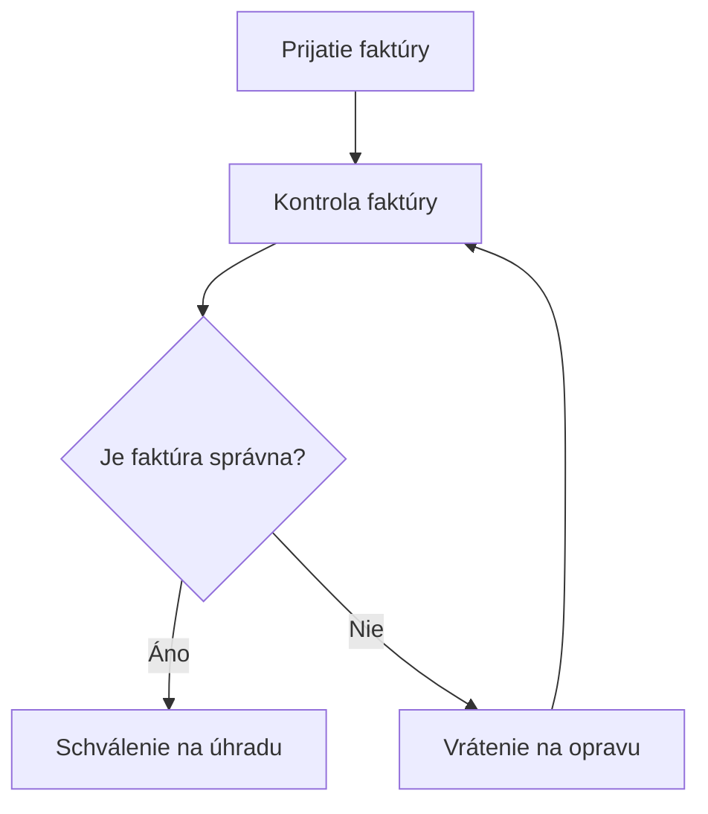
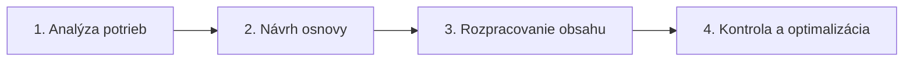

# 🧪 Promptovacie techniky – praktický sprievodca

**Osem techník promptovania v ChatGPT, Google Gemini a ďalších jazykových modeloch.** Tento dokument slúži ako praktický študijný materiál: pri každej technike vysvetľujeme princíp, použitie, zadanie pripravené na skopírovanie a spôsob kontroly výsledku.

**Podklad:** prezentácia *Promptovacie Techniky ok.pdf* (34 strán). Text, scenáre, čísla a ukážky vychádzajú z tejto prezentácie. Kde dokument obsahuje doplňujúce vysvetlenie, príklady výstupov alebo metodické upozornenia, výslovne ich odlišujeme od pôvodných zadaní.

**Súvisiace materiály:** [prompt-engineering.md](prompt-engineering.md) – komponenty promptu, GIGO a frameworky RTF, RISEN, CREATE a CRISPE.

> **Základný princíp:** Jednoduchý, jednoznačný prompt s relevantnými údajmi býva užitočnejší než zdĺhavé zadanie bez podstatného kontextu. Žiadna technika sama osebe nezaručuje odbornú ani faktickú správnosť odpovede.

## 📚 Obsah

1. [Prehľad ôsmich techník](#prehlad)
2. [Zero-shot prompting](#zero-shot)
3. [One-shot prompting](#one-shot)
4. [Few-shot prompting](#few-shot)
5. [Porovnanie na rovnakých pracovných úlohách](#porovnanie)
6. [Role prompting](#role)
7. [Contextual prompting](#contextual)
8. [Constraint-based prompting](#constraints)
9. [Output-format prompting](#format)
10. [Formáty výstupov v ChatGPT a Gemini](#formaty)
11. [Prompt chaining](#chaining)
12. [Placeholdery a opakovateľné šablóny](#placeholdery)
13. [Praktické cvičenia](#cvicenia)
14. [Kontrolný zoznam a zdroje](#kontrola)

<a id="prehlad"></a>
## 📌 1. Prehľad ôsmich promptovacích techník

**Promptovacia technika** je konkrétny spôsob, ako zadanie zostavíme alebo rozdelíme. Nie je to samostatné tlačidlo ani univerzálna funkcia modelu.

| Č. | Technika | Základný princíp | Typické pracovné využitie |
|---:|---|---|---|
| 1 | **Zero-shot prompting** | Zadanie bez vzorového príkladu | Prvé návrhy, sumarizácia, klasifikácia |
| 2 | **One-shot prompting** | Zadanie s jedným vzorovým príkladom | Opakovateľné úpravy textov, prevod poznámok |
| 3 | **Few-shot prompting** | Zadanie s viacerými vzorovými príkladmi | Jednotný štýl, kategorizácia, konzistentný formát |
| 4 | **Role prompting** | Určenie odbornej perspektívy alebo spôsobu vysvetlenia | Manažment, marketing, copywriting |
| 5 | **Contextual prompting** | Poskytnutie súvislostí, údajov a dokumentov | Reporty, pracovné porady, reklamácie, interné pravidlá |
| 6 | **Constraint-based prompting** | Určenie pravidiel, limitov a podmienok | Firemná komunikácia, presné výstupy, kontrola faktov |
| 7 | **Output-format prompting** | Určenie podoby a štruktúry výsledku | Tabuľky, Markdown, JSON, PDF, grafy, diagramy |
| 8 | **Prompt chaining** | Rozdelenie úlohy na nadväzujúce prompty | Kampane, analýzy, reporty, zaškolenie |

Techniky **môžeme kombinovať**. Napríklad zadanie môže mať rolu copywritera, obsahovať údaje o produkte, obmedzenie 150 slov a požadovať tabuľku. Stále ide o jeden prompt, v ktorom sme využili viacero postupov.

<a id="zero-shot"></a>
## 🟢 2. Zero-shot prompting – bez vzorového príkladu

Pri **zero-shot** technike vysvetlíme úlohu bez ukážky požadovaného prevodu či výsledku. Model sa musí riadiť slovným zadaním. Počet vzorových príkladov je **0**, čo neznamená, že prompt nemôže obsahovať vstupný text alebo iné údaje.

### Príklad 1 – úprava pracovného e-mailu (PDF, s. 4)

```text
Prepíš nasledujúci text do profesionálnej, stručnej a zdvorilej
podoby. Zachovaj pôvodný význam a nepridávaj nové informácie.

Text: „Ahoj, ten report ešte nie je hotový, lebo mi chýbajú
nejaké údaje od kolegov. Keď ich dostanem, dokončím to
a pošlem. Zatiaľ neviem kedy.“
```

**Čo sledujeme:** či sa zmení tón a zrozumiteľnosť bez vymyslenia dátumu dokončenia. V tomto príklade **nepoznáme termín**, a preto ho odpoveď nesmie vytvoriť.

### Príklad 2 – pracovné poznámky na zoznam úloh (PDF, s. 6)

```text
Premeň nasledujúce pracovné poznámky na prehľadný zoznam
úloh. Pri každej úlohe uveď zodpovednú osobu a termín.
Chýbajúce informácie označ ako „Neurčené“.

Poznámky: „Jana pošle podklady do štvrtka. Potom treba
upraviť prezentáciu. Peter má skontrolovať rozpočet.
Zákazníkovi musíme odpovedať do piatka.“
```

**Očakávaná kontrola:** Jana má uvedený termín štvrtok, pri Petrovi termín chýba; pri úprave prezentácie a odpovedi zákazníkovi nie je uvedená zodpovedná osoba.

**Kedy zvoliť zero-shot:** keď je samotná úloha zrozumiteľná a nie je potrebné učiť model osobitný vzorec výstupu.

<a id="one-shot"></a>
## 🟠 3. One-shot prompting – jeden vzorový príklad

Pri **one-shot** poskytneme **1 vzor**, ideálne vo dvojici **vstup → očakávaný výstup**. Model má následne upraviť ďalší vstup rovnakým spôsobom.

### Príklad 1 – jednotný tón e-mailu (PDF, s. 4)

```text
Prepíš nasledujúci text do profesionálnej, stručnej
a zdvorilej podoby. Zachovaj pôvodný význam
a nepridávaj nové informácie.

Vzorový príklad:
Vstup: „Ahoj, dnes to nestihnem, mám toho veľa,
pošlem ti to zajtra.“
Výstup: „Podklady dnes nestihnem dokončiť.
Zašlem vám ich zajtra.“

Teraz uprav tento text:
„Ahoj, ten report ešte nie je hotový, lebo mi chýbajú
nejaké údaje od kolegov. Keď ich dostanem, dokončím
to a pošlem. Zatiaľ neviem kedy.“
```

**Prínos vzoru:** model vidí nielen požadovaný tón, ale aj úroveň stručnosti, použitie vykania a štruktúru odpovede.

### Príklad 2 – jednotná evidencia úloh (PDF, s. 6)

```text
Premeň nasledujúce pracovné poznámky na prehľadný
zoznam úloh. Pri každej úlohe uveď zodpovednú osobu
a termín. Chýbajúce informácie označ ako „Neurčené“.

Vzorový príklad:
Poznámka: „Martin pripraví cenovú ponuku do stredy.“
Výstup:
Úloha: Pripraviť cenovú ponuku
Zodpovedný: Martin
Termín: Streda

Teraz spracuj:
„Jana pošle podklady do štvrtka. Potom treba upraviť
prezentáciu. Peter má skontrolovať rozpočet.
Zákazníkovi musíme odpovedať do piatka.“
```

**Dôležité:** Vzorový príklad je ukážka formátu, nie ďalšia úloha, ktorú treba zaradiť do výsledného zoznamu.

<a id="few-shot"></a>
## 🔵 4. Few-shot prompting – viacero vzorových príkladov

Pri **few-shot** pridáme **viacero vzorov**, aby model videl opakujúci sa vzorec. V prezentácii používame tri vzory na každý typ úlohy.

### Príklad 1 – profesionálna komunikácia (PDF, s. 5)

```text
Prepíš nasledujúci text do profesionálnej, stručnej
a zdvorilej podoby. Zachovaj pôvodný význam
a nepridávaj nové informácie.

Vzorový príklad 1:
Vstup: „Ahoj, dnes to nestihnem, mám toho veľa,
pošlem ti to zajtra.“
Výstup: „Podklady dnes nestihnem dokončiť.
Zašlem vám ich zajtra.“

Vzorový príklad 2:
Vstup: „Čau, pozrel si už ten dokument?
Potrebujem vedieť, či je OK.“
Výstup: „Prosím o informáciu, či ste už dokument
skontrolovali a či je v poriadku.“

Vzorový príklad 3:
Vstup: „Ten termín asi nedáme, ešte nemáme všetky
veci. Ozvem sa, keď budem vedieť viac.“
Výstup: „Pôvodný termín pravdepodobne nestihneme,
pretože nám chýbajú potrebné podklady. O ďalšom
postupe vás budem informovať.“

Teraz uprav tento text:
„Ahoj, ten report ešte nie je hotový, lebo mi chýbajú
nejaké údaje od kolegov. Keď ich dostanem, dokončím
to a pošlem. Zatiaľ neviem kedy.“
```

### Príklad 2 – prevod poznámok na pracovné úlohy (PDF, s. 7)

```text
Premeň nasledujúce pracovné poznámky na prehľadný
zoznam úloh. Pri každej úlohe uveď zodpovednú osobu
a termín. Chýbajúce informácie označ ako „Neurčené“.

Vzorový príklad 1:
Poznámka: „Martin pripraví cenovú ponuku do stredy.“
Úloha: Pripraviť cenovú ponuku
Zodpovedný: Martin
Termín: Streda

Vzorový príklad 2:
Poznámka: „Treba aktualizovať dokumentáciu.“
Úloha: Aktualizovať dokumentáciu
Zodpovedný: Neurčené
Termín: Neurčené

Vzorový príklad 3:
Poznámka: „Eva má do piatka skontrolovať faktúry.“
Úloha: Skontrolovať faktúry
Zodpovedný: Eva
Termín: Piatok

Teraz spracuj:
„Jana pošle podklady do štvrtka. Potom treba upraviť
prezentáciu. Peter má skontrolovať rozpočet.
Zákazníkovi musíme odpovedať do piatka.“
```

**Poznámka k podkladu:** Na snímke 7 je titulok „Few-shot Komunikácia“, hoci obsahom ide o **zoznam pracovných úloh**. V dokumente používame názov podľa skutočného obsahu.

<a id="porovnanie"></a>
## ⚖️ 5. Porovnanie rovnakého zadania v troch variantoch

Aby sme rozlíšili efekt počtu ukážok, **nemeníme cieľovú úlohu ani vstupné údaje**. Mení sa iba počet vzorov.

| Kritérium | Zero-shot | One-shot | Few-shot |
|---|---|---|---|
| Počet vzorov | 0 | 1 | Viacero, napr. 3 |
| Slovný opis úlohy | Áno | Áno | Áno |
| Ukážka štýlu | Nie | Jedna | Viacero |
| Typické použitie | Bežné zrozumiteľné úlohy | Jednotlivé opakovateľné úpravy | Ustálený vzor pre viac vstupov |
| Obmedzenie | Výstup môže byť menej jednotný | Jeden vzor nemusí pokryť výnimky | Chybné alebo nekonzistentné vzory môžu skresliť odpoveď |

### Demonštračný experiment

1. Spustíme **zero-shot** prompt na úpravu e-mailu.
2. Na **rovnaký vstupný e-mail** použijeme variant s jednou ukážkou.
3. Opakujeme zadanie s tromi ukážkami.
4. Porovnáme zdvorilosť, zachovanie významu, stručnosť, výmysly a konzistentnosť.

**Záver:** Viac príkladov automaticky neznamená lepší výsledok. Dôležité sú kvalita, relevancia a vzájomná konzistentnosť ukážok.

<a id="role"></a>
## 🟣 6. Role prompting – priradenie odbornej roly AI

Role prompting určuje **odbornú perspektívu, jazyk a typ vysvetlenia**, nie reálnu kvalifikáciu modelu. Vzorom môžeme začať slovami „Vystupuj ako...“.

### Príklad A – manažér tímu (PDF, s. 8)

```text
Vystupuj ako skúsený manažér tímu. Vysvetli,
ako efektívne organizovať pracovný deň.
Zameraj sa na priority, delegovanie úloh
a dodržiavanie termínov.
```

### Príklad B – marketingový špecialista (PDF, s. 8)

```text
Vystupuj ako skúsený marketingový špecialista.
Vysvetli, ako efektívne organizovať pracovný deň.
Zameraj sa na plánovanie marketingových kampaní,
tvorbu obsahu, správu sociálnych sietí,
vyhodnocovanie výsledkov a dodržiavanie termínov.
```

### Príklad C – manažér riešiaci termín uvedenia produktu (PDF, s. 9)

```text
Vystupuj ako skúsený manažér tímu. Naša firma
o 7 dní spúšťa nový produkt, ale nestíhame dokončiť
web, pripraviť reklamu a informovať zákazníkov.
Máme troch zamestnancov a obmedzený rozpočet 1 000 €.
Navrhni 5 prioritných krokov, rozdelenie zodpovedností
a harmonogram, aby sme stihli termín.
```

### Príklad D – reklamný copywriter (PDF, s. 9)

```text
Vystupuj ako skúsený reklamný copywriter so zameraním
na tvorbu predajných textov. Naša firma uvádza na trh
nový ergonomický kancelársky stôl s nastaviteľnou výškou.
Vytvor pútavý predajný text pre e-shop v rozsahu do 150 slov,
ktorý osloví ľudí pracujúcich v kancelárii aj z domu.
Zdôrazni možnosť striedania práce v sede a v stoji,
pohodlie a praktické využitie. Navrhni 3 reklamné
nadpisy, krátky popis produktu a výzvu na nákup (CTA).
Použi presvedčivý, ale prirodzený jazyk bez prehnaných
reklamných sľubov a bez vaty.
```

**Vysvetlenie:** Príklady A a B sa viac spoliehajú na rolu. C a D okrem roly pridávajú **konkrétny kontext a obmedzenia**, preto sú praktickejšie pre okamžité použitie.

> **Upozornenie:** „Vystupuj ako skúsený odborník“ nezaručuje správnosť ani overenú kvalifikáciu. Pri financiách, práve, bezpečnosti a ďalších odborných oblastiach rozhodnutia a kľúčové údaje samostatne kontrolujeme.

<a id="contextual"></a>
## 🟢 7. Contextual prompting – kontext a vstupné údaje

Dodáme údaje, dokumenty, okolnosti a účel zadania. Relevantný kontext pomáha modelu odpovedať konkrétnejšie a menej všeobecne.

**Typické vstupy:** zápis z porady, zákaznícky e-mail, finančné výsledky, pracovná smernica, sylabus alebo tabuľka. Ak sa odvolávame na prílohu, **musíme ju skutočne pripojiť a sprístupniť**.

### Príklad 1 – zhrnutie pracovnej porady (PDF, s. 11)

```text
Priprav zhrnutie priloženého zápisu z pracovnej porady.
Zúčastnilo sa jej 8 zamestnancov a riešili sme
termíny projektov, rozdelenie úloh a aktuálne problémy.
```

**Podklad:** priložíme zápis. Bez zápisu model nedokáže spoľahlivo určiť konkrétne termíny a mená.

### Príklad 2 – odpoveď zákazníkovi (PDF, s. 11)

```text
Zákazník nám napísal, že jeho objednávka mešká 4 dni.
Objednal si kancelársku stoličku za 250 €.
Dopravca oznámil, že zásielku doručí najneskôr v piatok.
Zákazník požaduje vysvetlenie a nápravu.
Priprav odpoveď na jeho e-mail.
```

**Čo sledujeme:** správne uvedenie doby meškania a potvrdeného termínu bez vymyslenej kompenzácie.

### Príklad 3 – prezentácia pre vedenie (PDF, s. 11)

```text
Pripravujem prezentáciu pre vedenie firmy o výsledkoch
za posledný štvrťrok. Tržby vzrástli o 12 %, počet nových
zákazníkov o 8 %, ale reklamácie sa zvýšili o 15 %.
Vedenie potrebuje rozhodnúť o prioritách na ďalší
štvrťrok. Navrhni osnovu prezentácie, ktorá pomôže
vedeniu identifikovať najdôležitejšie výsledky
a oblasti vyžadujúce pozornosť.
```

**Čo sledujeme:** odlíšenie zistení od príčin, ktoré zadanie neobsahuje.

### Príklad 4 – interné pracovné pravidlá (PDF, s. 11)

```text
Analyzuj priložený 20-stranový dokument s novými
internými pravidlami firmy. Potrebujem zistiť,
aké zmeny sa týkajú bežných zamestnancov,
odkedy platia a aké povinnosti z nich vyplývajú.
```

**Čo sledujeme:** či sú všetky tvrdenia dohľadateľné v priloženom dokumente; dôležité zmeny môžeme doplniť o číslo strany.

<a id="constraints"></a>
## 🔴 8. Constraint-based prompting – pravidlá a obmedzenia

Touto technikou stanovíme **konkrétne, zrozumiteľné a kontrolovateľné požiadavky**. Pozitívne formulované inštrukcie často lepšie vysvetlia očakávaný výstup než všeobecné zákazy.

Príklad formulácie: namiesto „Nepíš komplikovane“ použijeme „Používaj krátke vety a vysvetli každý odborný termín“.

### Desať typov obmedzení (PDF, s. 13)

| Typ | Čo určuje | Praktické príklady |
|---|---|---|
| **1. Rozsahové** (*Length & Scope*) | Dĺžka a množstvo obsahu | Maximálne 150 slov; presne 5 odporúčaní; najviac 6 snímok; maximálne 10 riadkov kódu |
| **2. Obsahové** (*Content*) | Čo zahrnieme a vylúčime | Sústreď sa na praktické odporúčania; vynechaj historický vývoj; zahrň iba zmeny pre zamestnancov |
| **3. Štylistické** (*Style & Tone*) | Jazyk, tón a odbornosť | Profesionálny a zdvorilý tón; krátke vety; bez žargónu; empatická odpoveď |
| **4. Formátové** (*Output Format*) | Štruktúru a technický formát | Tabuľka so 4 stĺpcami; nadpisy H2 a H3; číslovaný zoznam; JSON |
| **5. Faktické** (*Factual Accuracy*) | Pravidlá tvrdení a neistoty | Nevymýšľaj mená, dátumy ani štatistiky; označ neoverené tvrdenia; uveď zdroj |
| **6. Procesné** (*Process*) | Poradie a metódu spracovania | Najprv vyhodnoť vstupy; potom navrhni riešenia; porovnaj alternatívy; oddeľ fakty od hypotéz |
| **7. Časové** (*Time*) | Termíny a časové limity | Údaje za rok 2026; plán na 5 dní; termín do piatka; vyhraď 30 minút |
| **8. Zdrojové** (*Sources*) | Povolené informačné zdroje | Len priložené súbory; oficiálna dokumentácia; odkaz na zdroj ku každému tvrdeniu |
| **9. Technické** (*Technical*) | Kompatibilitu, technológie a dátové požiadavky | Python 3.13; Windows 11; bez externých knižníc; CSV s bodkočiarkou |
| **10. Kvalitatívne** (*Quality*) | Kritériá použiteľnosti a kvality | Realizovateľné návrhy; odstránenie duplicít; kontrola terminológie; upozornenie na rozpory |

**Metodická poznámka:** Presný počet slov, formát a splnenie technických pravidiel treba po vytvorení výstupu skontrolovať. Inštrukcia sama osebe nie je technickou validáciou.

### Príklad 1 – zhrnutie porady s obmedzeniami (PDF, s. 12)

Tento prompt použijeme spolu s **kontextom z príkladu 1**.

```text
Priprav zhrnutie porady v 5 bodoch. Pri identifikovaných
úlohách uveď zodpovednú osobu a termín. Použi výlučne
informácie zo zápisu. Ak údaj chýba, označ ho ako
neurčený. Nevymýšľaj mená ani dátumy.
```

### Príklad 2 – zákaznícka odpoveď s obmedzeniami (PDF, s. 12)

Použijeme **údaje o meškajúcej objednávke z príkladu 2**.

```text
Odpoveď napíš v maximálne 120 slovách. Použi zdvorilý
a empatický tón. Uveď potvrdený termín doručenia,
ospravedlnenie a ďalší postup. Nesľubuj finančnú
kompenzáciu ani skoršie doručenie.
```

### Príklad 3 – osnova manažérskej prezentácie (PDF, s. 12)

Použijeme **štvrťročné ukazovatele z príkladu 3**.

```text
Priprav osnovu maximálne 6 snímok. Každá snímka
musí obsahovať jeden hlavný záver. Používaj len
uvedené čísla, nevymýšľaj príčiny zmien.
Oddeľ potvrdené zistenia od hypotéz
a navrhni 3 konkrétne opatrenia.
```

### Príklad 4 – tabuľka zmien internej smernice (PDF, s. 12)

Použijeme **priložený interný dokument z príkladu 4**.

```text
Použi výlučne priložený dokument. Vytvor tabuľku
so stĺpcami Zmena, Koho sa týka, Termín účinnosti
a Číslo strany. Ak informácia chýba, napíš
„V dokumente neuvedené“. Nevyvodzuj právne závery
bez podkladov.
```

> **Rozdiel:** Kontext povie modelu, **z čoho má vychádzať**; obmedzenia určujú, **ako smie informácie spracovať**. V reálnom prompte sa tieto prvky bežne kombinujú.

<a id="format"></a>
## 🔵 9. Output-format prompting – určenie podoby výstupu

Definujeme, či má byť výsledkom tabuľka, Markdown, textový súbor, HTML, JSON, graf, SVG, Mermaid diagram, prezentácia alebo iný artefakt. Vybraný formát prispôsobíme ďalšiemu použitiu.

### Príklad 1 – Mermaid proces schvaľovania faktúry (PDF, s. 15–16)

**Prompt:**

```text
Vytvor Mermaid flowchart procesu schvaľovania faktúry.
Faktúru najprv prijmeme, potom skontrolujeme.
Ak je správna, schválime ju na úhradu.
Inak ju vrátime na opravu.
```

**Ilustračný možný výstup:**



**Vysvetlenie:** Mermaid je textový zápis diagramu, ktorý GitHub môže vykresliť priamo v Markdown dokumente. Uvedený diagram je ilustračná rekonštrukcia postupu zo snímky.

### Príklad 2 – SVG vektorová ikona (PDF, s. 15)

```text
Vytvor SVG ikonu dokumentu s rozmermi 64 × 64 pixelov.
Použi fialovú farbu a transparentné pozadie.
Vráť iba SVG kód.
```

**Čo kontrolujeme:** koreňový element `<svg>`, rozmery `64 × 64`, transparentnosť a validitu XML/SVG. Ak potrebujeme hotový súbor, požiadame o jeho vytvorenie a následne ho otvoríme v prehliadači.

### Príklad 3 – stĺpcový graf mesačných tržieb (PDF, s. 15)

```text
Vytvor stĺpcový graf mesačných tržieb za január až jún.
Použi nasledujúce údaje:
január 12 000 €,
február 14 500 €,
marec 13 800 €,
apríl 17 200 €,
máj 19 000 €,
jún 21 500 €.

Doplň názov, osi a krátke zhodnotenie trendu.
```

**Čo kontrolujeme:** presné zobrazenie šiestich hodnôt a jednotku **€** na osi. Model nesmie doplniť ďalšie mesiace, pre ktoré nemáme údaje.

### Príklad 4 – skutočný PDF report pre vedenie (PDF, s. 17–19)

```text
Vytvor dvojstranový PDF report o výsledkoch obchodného
oddelenia za október 2026 aj grafmi.
Report je určený vedeniu firmy na vyhodnotenie
výkonnosti a plánovanie ďalšieho mesiaca.

Vstupné údaje:
Celkové tržby: 45 000 €
Plánované tržby: 40 000 €
Počet objednávok: 125
Počet nových zákazníkov: 12
Počet reklamácií: 5
Marketingové náklady: 3 500 €
Tržby za september: 41 000 €
Počet objednávok za september: 110

Požadovaná štruktúra PDF:
Prvá strana: Titulná časť s názvom reportu, obdobím,
prehľadom hlavných KPI a stĺpcovým grafom
porovnávajúcim tržby za september a október.

Druhá strana: Tabuľka výsledkov, percentuálne zmeny,
tri hlavné zistenia a päť konkrétnych odporúčaní
na ďalší mesiac.

Požiadavky:
- Použi profesionálny firemný dizajn s modrými
  a sivými akcentmi.
- Vypočítaj percentuálny rast tržieb, plnenie plánu
  a priemernú hodnotu objednávky.
- Používaj iba poskytnuté údaje a správne
  matematické výpočty.
- Nevymýšľaj chýbajúce informácie ani nepodložené
  príčiny zmien.
- Výsledok vytvor ako skutočný PDF súbor na stiahnutie,
  nie iba ako text v chate.
- Pred odovzdaním skontroluj výpočty, čitateľnosť
  a presný počet dvoch strán.
```

**Overiteľné ukazovatele z poskytnutých údajov (doplnený kontrolný výpočet):**

| Ukazovateľ | Výpočet | Výsledok |
|---|---|---:|
| Rast tržieb oproti septembru | (45 000 − 41 000) / 41 000 × 100 | **+9,76 %** |
| Plnenie októbrového plánu | 45 000 / 40 000 × 100 | **112,50 %** |
| Prekročenie plánu | 45 000 − 40 000 | **5 000 €** |
| Zmena počtu objednávok | (125 − 110) / 110 × 100 | **+13,64 %** |
| Priemerná objednávka v septembri | 41 000 / 110 | **372,73 €** |
| Priemerná objednávka v októbri | 45 000 / 125 | **360,00 €** |

**Pozor:** Report nevie z týchto čísel sám preukázať, prečo tržby rástli. Odporúčania predstavujú **návrhy budúcich opatrení**, nie uskutočnené kroky. Reálna tvorba súboru PDF závisí od funkcií prostredia, v ktorom prompt spúšťame.

<a id="formaty"></a>
## 📁 10. Formáty výstupov v ChatGPT a Gemini

Nasledujúca tabuľka sumarizuje **formáty a typy výstupov z prezentácie (s. 20–21)**. Rozlišujeme textový výstup a vytvorenie skutočného súboru. Dostupnosť súborových exportov, vizualizácií alebo prepojených aplikácií sa môže líšiť podľa používaného produktu, plánu a aktuálneho rozhrania.

| Kategória | Formát / typ výstupu | Praktické použitie | Typická podoba |
|---|---|---|---|
| Text | **TXT** | E-maily, stručné odpovede, poznámky | Text alebo súbor |
| Text | **Markdown (MD)** | README, články, návody, dokumentácia | Formátovaný text alebo `.md` |
| Text | **Rich Text (RTF)** | Formátované texty pre kancelárske nástroje | Dokument / súbor |
| Dokumenty | **PDF** | Reporty, príručky, dokumenty na tlač | `.pdf`, ak je export podporovaný |
| Dokumenty | **Word (DOCX)** | Smernice, zápisy, ponuky, šablóny | `.docx` |
| Tabuľky | **Excel (XLSX)** | Rozpočty, analýzy, grafy, evidencie | `.xlsx` |
| Prezentácie | **PowerPoint (PPTX)** | Školenia, porady, projektové reporty | `.pptx` |
| Cloud | **Google Docs / Sheets / Slides** | Spolupráca nad dokumentmi a tabuľkami | Prepojená aplikácia alebo export |
| Grafika | **Graf / vizualizácia** | Tržby, KPI, porovnania, trendy | Graf v chate / obrázok / súbor |
| Grafika | **PNG / JPG** | Ilustrácie, marketingová grafika | Obrázok / súbor |
| Web | **HTML** | Webové stránky, newslettery, WordPress | Zdrojový kód / `.html` |
| Dáta | **JSON** | API, automatizácie, štruktúrované údaje | Kód / `.json` |
| Dáta | **CSV** | Importy, exporty, tabuľkové údaje | Text / `.csv` |
| Dáta | **TSV** | Tabuľkové dáta oddelené tabulátorom | Text / `.tsv` |
| Dáta | **XML** | Systémové integrácie, konfigurácie | Kód / `.xml` |
| Konfigurácia | **YAML (YML)** | CI/CD, Docker Compose, Kubernetes | Kód / `.yaml` |
| Databázy | **SQL** | Databázové dopyty, reporty | Kód / `.sql` |
| Programovanie | **Python / JavaScript / ďalší kód** | Skripty, automatizácie, testy | Kód / zdrojový súbor |
| Diagramy | **Mermaid** | Flowcharty, vývojové a architektonické diagramy | Textový diagram |
| Vektorová grafika | **SVG** | Ikony, schémy, grafické prvky webu | XML kód / `.svg` |

> **Dôležité rozlíšenie:** Samotná požiadavka „vráť JSON“ alebo „vytvor PDF“ ešte neznamená, že výsledok je validný JSON alebo fyzicky existujúci PDF súbor. Výstup potrebujeme skontrolovať v príslušnom formáte a overiť, či sa súbor skutočne vytvoril.

### Príklad – presne definovaná JSON štruktúra

```text
Z nasledujúcich pracovných poznámok vytvor pole JSON.
Každá položka musí obsahovať polia:
uloha (string), zodpovedny (string alebo null),
termin (string alebo null).

Nevymýšľaj chýbajúce údaje; pri chýbajúcich
hodnotách použi null. Vráť iba validný JSON
bez Markdownu a komentárov.

Poznámky: „Jana pošle podklady do štvrtka.
Peter má skontrolovať rozpočet.“
```

**Ilustračný možný výstup:**

```json
[
  {
    "uloha": "Poslať podklady",
    "zodpovedny": "Jana",
    "termin": "štvrtok"
  },
  {
    "uloha": "Skontrolovať rozpočet",
    "zodpovedny": "Peter",
    "termin": null
  }
]
```

Tento príklad je **metodickým doplnením** k časti o JSON, nie citáciou konkrétneho výstupu na snímke.

<a id="chaining"></a>
## 🔗 11. Prompt chaining – reťazenie nadväzujúcich úloh

Zložitejšiu úlohu rozdelíme na viacero promptov. **Výstup jedného kroku použijeme ako podklad pre ďalší.** Po každom kroku môžeme doplniť vstupy, opraviť chyby a určiť ďalší smer.

### Základná schéma (PDF, s. 22)



**Vysvetlenie:** V jednom chate môžeme nadviazať na dostupné predchádzajúce výstupy. V novej konverzácii nepredpokladáme úplný prenos kontextu; potrebné údaje znova priložíme. Pamäť používateľa nie je zárukou, že model má k dispozícii presný obsah minulého rozhovoru.

### Scenár 1 – marketingová kampaň novej služby (PDF, s. 23)

**Prompt 1 – Analýza cieľovej skupiny**

```text
Naša firma spúšťa službu pravidelného doručovania
obedov do kancelárií v Bratislave. Cena jedného obeda
je 8,90 € a doručujeme počas pracovných dní.
Identifikuj tri potenciálne cieľové skupiny,
ich potreby, nákupné motivácie a možné námietky.
```

**Prompt 2 – Návrh marketingovej stratégie**

```text
Na základe identifikovaných cieľových skupín navrhni
marketingovú kampaň na prvých 30 dní.
Máme rozpočet 1 500 €. Odporuč komunikačné kanály,
rozdelenie rozpočtu a hlavné reklamné posolstvá.
Vysvetli, ako jednotlivé aktivity oslovia vybrané
cieľové skupiny.
```

**Prompt 3 – Tvorba reklamných textov**

```text
Z navrhnutej marketingovej stratégie vytvor päť
reklamných textov na Facebook a Instagram,
tri e-mailové predmety a krátky predajný text na web.
Zachovaj jednotné hlavné posolstvo, ale prispôsob
komunikáciu jednotlivým cieľovým skupinám.
```

**Prompt 4 – Kontrola a optimalizácia**

```text
Skontroluj pripravené reklamné texty z pohľadu
zrozumiteľnosti, dôveryhodnosti a presvedčivosti.
Identifikuj slabé formulácie a navrhni lepšie varianty.
Nevymýšľaj zľavy, garancie ani vlastnosti služby,
ktoré sme neuviedli.
```

**Kontrolný bod:** Pri 2. kroku je rozpočet **1 500 €** celkovým limitom, nie rozpočtom každého kanála.

### Scenár 2 – zákaznícka spätná väzba (PDF, s. 24)

**Prompt 1 – Analýza spätnej väzby**

```text
Analyzuj nasledujúce pripomienky zákazníkov:
„Na odpoveď čakám už 3 dni.“
„Objednávkový formulár je neprehľadný.“
„Neprišlo mi potvrdenie objednávky.“
„Na webe neviem nájsť kontaktné údaje.“

Identifikuj hlavné problémy, zoskup ich podľa tém
a vysvetli ich možný dopad na zákaznícku skúsenosť.
```

**Prompt 2 – Určenie priorít**

```text
Na základe predchádzajúcej analýzy vyber 3 problémy,
ktoré by sme mali riešiť ako prvé. Zohľadni
závažnosť problému, možný dopad na zákazníkov
a náročnosť riešenia. Vysvetli svoje poradie.
```

**Prompt 3 – Akčný plán**

```text
Z troch prioritných problémov vytvor konkrétny
plán zlepšení na nasledujúcich 14 dní.
Pri každom opatrení uveď potrebné kroky,
navrhovanú zodpovednú rolu, termín
a spôsob merania výsledku.
```

**Prompt 4 – Komunikácia vedeniu**

```text
Z pripraveného akčného plánu vytvor stručný
manažérsky report. Použi tabuľku s problémami,
odporúčanými opatreniami a prioritami.
Na záver priprav krátky e-mail, ktorým vedeniu
predstavíme navrhované zlepšenia.
Neuvádzaj plánované opatrenia ako už uskutočnené.
```

**Kontrolný bod:** Zákaznícke pripomienky predstavujú vstupné pozorovania. Náročnosť riešenia a možné dopady sú **odhady**, ktoré musíme pred realizáciou overiť.

### Scenár 3 – obchodné výsledky a report (PDF, s. 25)

**Prompt 1 – Analýza údajov**

```text
Analyzuj výsledky obchodného oddelenia.
V septembri sme dosiahli tržby 41 000 € a 110
objednávok. V októbri boli tržby 45 000 €
a počet objednávok 125. Októbrový plán bol 40 000 €.
Vypočítaj medzimesačné zmeny, plnenie plánu
a priemernú hodnotu objednávky.
Výsledky zobraz v tabuľke.
```

**Prompt 2 – Interpretácia výsledkov**

```text
Na základe vypočítaných ukazovateľov identifikuj
tri najdôležitejšie zistenia. Vysvetli, čo výsledky
znamenajú pre obchodné oddelenie. Oddeľ potvrdené
zistenia od možných vysvetlení.
Nevymýšľaj príčiny rastu tržieb.
```

**Prompt 3 – Odporúčania**

```text
Na základe predchádzajúcej analýzy navrhni 5
konkrétnych opatrení na nasledujúci mesiac.
Pri každom opatrení uveď jeho účel, očakávaný
prínos a spôsob merania úspešnosti.
Očakávané prínosy jasne odlíš od potvrdených
výsledkov.
```

**Prompt 4 – Vytvorenie PDF reportu**

```text
Zo všetkých predchádzajúcich výstupov vytvor
dvojstranový PDF report pre vedenie firmy.
Na prvej strane zobraz KPI a graf vývoja tržieb.
Na druhej strane priprav tabuľku výsledkov,
tri hlavné zistenia a päť odporúčaní.
Použi profesionálny dizajn s modrými
a sivými akcentmi. Skontroluj všetky výpočty.
```

**Kontrolný bod:** Finálny report sa nesmie opierať o nepodložené príčiny zmien. Priemer objednávky vyhodnocujeme za **každý mesiac z jeho vlastných tržieb a počtu objednávok**.

### Scenár 4 – zaškolenie nového zamestnanca (PDF, s. 26)

**Prompt 1 – Identifikácia zručností**

```text
Do firmy nastupuje nový administratívny pracovník.
Bude spracovávať e-maily, objednávky, faktúry
a pracovať s Excelom. Nemá skúsenosti s našimi
internými procesmi. Identifikuj potrebné pracovné
zručnosti a rozdeľ ich podľa dôležitosti.
```

**Prompt 2 – Plán zaškolenia**

```text
Na základe predchádzajúceho zoznamu zručností
priprav päťdňový plán zaškolenia. Pri každom dni
uveď vzdelávací cieľ, konkrétne aktivity,
praktické cvičenie a očakávaný výsledok.
```

**Prompt 3 – Praktické úlohy**

```text
K pripravenému plánu vytvor desať praktických
pracovných úloh. Zameraj sa na e-mailovú komunikáciu,
evidenciu objednávok, kontrolu faktúr
a prácu s Excelom. Úlohy usporiadaj
od jednoduchých po náročnejšie.
```

**Prompt 4 – Vyhodnotenie zaškolenia**

```text
Na základe plánu a praktických úloh priprav
hodnotiaci formulár. Definuj merateľné kritériá
úspešnosti, bodovacie hodnotenie a kontrolný
zoznam zručností, ktoré má zamestnanec zvládnuť
po prvom týždni.
```

**Kontrolný bod:** Ak nemáme interné procesy opísané, výsledok je len **návrh školenia**, nie záväzná firemná metodika.

### Prompt chaining v rozšíreniach a aplikáciách (PDF, s. 27–28, 32–34)

Prezentácia ukazuje používateľské rozhrania na tvorbu reťazcov promptov, zadávanie premenných a uloženie šablón. Ide o **ukážky konkrétnych rozšírení či rozhraní**, nie o dôkaz, že každý ChatGPT alebo Gemini obsahuje rovnaké vstavané ovládacie prvky.

Pri reťazci s premennými napríklad vyplníme:

| Premenná | Ukážková hodnota |
|---|---|
| `Topic` | Zavádzanie umelej inteligencie do kancelárskej práce |
| `Target_audience` | Administratívni pracovníci a manažéri |
| `{topic}` | Kybernetická bezpečnosť zamestnancov |

**Vysvetlenie:** Tieto hodnoty sú **doplnené demonštračné vstupy**. Konkrétna aplikácia môže používať vlastný zápis a spôsob dosadzovania premenných.

<a id="placeholdery"></a>
## 🧩 12. Placeholdery – zástupné premenné v promptoch

**Placeholder** je zástupný text (napr. `{TÉMA}` alebo `[TÉMA]`), ktorý pri opakovanom použití šablóny nahradíme konkrétnou hodnotou. Nie je to automaticky vstavaná funkcia AI; automatické dosadzovanie zabezpečuje prípadne až použitá aplikácia alebo skript.

### Bežné placeholdery (PDF, s. 29)

| Placeholder | Čo doplníme | Príklad hodnoty |
|---|---|---|
| `{TÉMA}` | Predmet spracovania | Projektové riadenie |
| `{CIEĽOVÁ_SKUPINA}` | Komu je obsah určený | Noví zamestnanci |
| `{POČET_BODOV}` | Rozsah výstupu | 5 |
| `{FORMÁT_VÝSTUPU}` | Podoba výstupu | Markdown tabuľka |
| `{ÚROVEŇ}` | Náročnosť | Začiatočník |
| `{ZDROJ_A}` | Prvý priložený dokument | Interná smernica A |
| `{ZDROJ_B}` | Druhý dokument | Interná smernica B |
| `{KRITÉRIUM}` | Hľadisko porovnania | Pracovné povinnosti |

### Šablóna 1 – výklad zo zdrojov (PDF, s. 30)

```text
Na základe nahraných zdrojov vysvetli tému {TÉMA}.

Cieľová skupina: {CIEĽOVÁ_SKUPINA}
Úroveň: {ÚROVEŇ}
Jazyk: {JAZYK}
Počet príkladov: {POČET_PRÍKLADOV}
Formát výstupu: {FORMÁT}

Použi iba informácie z vybraných zdrojov.
Ku každému dôležitému tvrdeniu pripoj citáciu.
Ak informácia v zdrojoch chýba, výslovne to uveď.
```

### Šablóna 2 – univerzálna sumarizácia (PDF, s. 31)

```text
Na základe vybraných zdrojov priprav zhrnutie
na tému {TÉMA}.
Cieľová skupina: {CIEĽOVÁ_SKUPINA}.
Rozsah: {POČET_BODOV} bodov.
Úroveň podrobnosti: {ÚROVEŇ}.
Výstup priprav vo forme {FORMÁT_VÝSTUPU}.
```

### Šablóna 3 – porovnanie zdrojov (PDF, s. 31)

```text
Porovnaj dokumenty {ZDROJ_A} a {ZDROJ_B}
z hľadiska {KRITÉRIUM}.

Výsledok priprav ako tabuľku:
Kritérium | Zdroj A | Zdroj B | Rozdiely.

Uveď citácie.
```

### Šablóna 4 – príprava otázok (PDF, s. 31)

```text
Priprav {POČET_OTÁZOK} otázok s krátkymi odpoveďami
na tému {TÉMA} pre používateľov na úrovni {ÚROVEŇ}.
Vychádzaj výhradne z vybraných zdrojov.
```

**Pracovný postup:** Šablónu skopírujeme → nahradíme všetky placeholdery → pridáme relevantné zdroje → odošleme prompt → overíme výsledok. Nevyplnený placeholder môže viesť k nejednoznačnej odpovedi.

<a id="cvicenia"></a>
## 🧪 13. Praktické cvičenia

Nasledujúce aktivity sú **metodicky doplnené cvičenia** založené na scenároch v PDF. Môžeme ich použiť pri školení alebo individuálnom tréningu.

### Cvičenie 1 – tri spôsoby úpravy e-mailu

Použijeme zadanie zo snímok **4–5** v troch podobách: zero-shot, one-shot a few-shot. Pri každom porovnáme zachovanie významu a či model nevytvoril neexistujúci termín.

### Cvičenie 2 – úlohy z pracovných poznámok

Podľa snímok **6–7** prevedieme poznámky na tabuľku so stĺpcami **Úloha | Zodpovedný | Termín | Stav údaja**. Výstupy rozlíšime podľa toho, či údaje pochádzajú zo vstupu alebo chýbajú.

### Cvičenie 3 – role prompting

Porovnáme manažérsku rolu a rolu reklamného copywritera podľa snímok **8–9**. Posúdime vhodnosť tónu, zameranie a mieru konkrétnosti. Zohľadníme, že obidve zadania majú odlišný pracovný cieľ.

### Cvičenie 4 – kontext plus obmedzenia

Spojíme situáciu s meškajúcou objednávkou zo snímky **11** s pravidlami zo snímky **12**. Skontrolujeme, či odpoveď používa potvrdený termín a nevymýšľa kompenzáciu.

### Cvičenie 5 – výstupný formát

Na tých istých údajoch o tržbách vytvoríme: (a) Markdown tabuľku, (b) graf a (c) štruktúrovaný JSON. Kontrolujeme správne prenesenie hodnôt a syntaktickú validitu, nie len vzhľad.

### Cvičenie 6 – nadväzujúca analýza

Prejdeme štyri kroky scenára obchodného reportu zo snímky **25**. Po analýze samostatne skontrolujeme výpočty, až potom pripravíme interpretáciu a odporúčania.

### Cvičenie 7 – opakovane použiteľná šablóna

Vyplníme placeholdery `{TÉMA}`, `{ÚROVEŇ}` a `{FORMÁT_VÝSTUPU}` v šablóne zo snímky **31**. Šablónu použijeme dvakrát na odlišnú tému bez zmeny jej základnej štruktúry.

<a id="kontrola"></a>
## ✅ 14. Kontrolný zoznam a zdroje

### Kontrolný zoznam kvality promptu

- [ ] Úloha je konkrétna, zrozumiteľná a má určený cieľ.
- [ ] Doplnili sme údaje, ktoré model naozaj potrebuje.
- [ ] Všetky uvedené prílohy sú skutočne dostupné.
- [ ] Rozhodli sme sa, či potrebujeme 0, 1 alebo viac vzorov.
- [ ] Rolu používame, keď pomáha určeniu perspektívy.
- [ ] Obmedzenia nie sú v rozpore so vstupnými údajmi.
- [ ] Je určený formát, rozsah a prípadne názvy stĺpcov.
- [ ] Model nemá dopĺňať mená, dátumy a fakty bez podkladov.
- [ ] Pri numerických úlohách sme preverili výpočty.
- [ ] Pri JSON, CSV, SVG alebo kóde sme preverili validitu.
- [ ] Pri PDF, DOCX alebo XLSX sme overili **existenciu súboru**, nie iba jeho prísľub.
- [ ] Pri prompt chainingu sme skontrolovali každý medzivýsledok.
- [ ] Pred odoslaním šablóny sme nahradili všetky placeholdery.
- [ ] Citlivé údaje zdieľame iba v primerane zabezpečenom prostredí.

### Časté chyby

| Chyba | Odporúčaná náprava |
|---|---|
| Zadanie je príliš všeobecné | Doplniť účel, cieľovú skupinu a vstupné údaje |
| Vzor obsahuje nesprávne údaje | Opraviť vzor pred few-shot použitím |
| Z roly vyvodzujeme garantovanú odbornosť | Skontrolovať výsledok podľa skutočných zdrojov |
| Od modelu žiadame údaje, ktoré nemá | Poskytnúť ich alebo požadovať „neuvedené“ |
| Požadovaný výstup nemá konkrétny formát | Uviesť stĺpce, dátové typy, štruktúru a spôsob exportu |
| Návrh považujeme za už realizovanú činnosť | Jednoznačne odlíšiť fakt, návrh a hypotézu |
| Každý krok reťazca vykonáme bez kontroly | Medzi krokmi overovať výstupy a opravovať chyby |

### Zdrojové podklady

- **Primárny zdroj:** *Promptovacie Techniky ok.pdf*, 34 strán (priložená prezentácia k školeniu).
- **S. 2–7:** Prehľad ôsmich techník a praktické porovnanie zero-shot, one-shot a few-shot.
- **S. 8–9:** Role prompting vrátane manažéra a copywritera.
- **S. 10–13:** Kontext, obmedzenia a desať typov obmedzení.
- **S. 14–21:** Formáty výstupov, Mermaid, SVG, PDF report, grafy a formáty v ChatGPT / Gemini.
- **S. 22–28:** Prompt chaining a štyri pracovné scenáre; ukážky rozhraní.
- **S. 29–34:** Placeholdery, opakovateľné šablóny a ukážky ich využitia.

**Súvisiace študijné materiály v repozitári:**

- [prompt-engineering.md](prompt-engineering.md) – komponenty kvalitného promptu, GIGO, frameworky a ďalšie príklady
- [ai-prompty-trening.md](ai-prompty-trening.md) – kontrolované prompty na tréning s AI textami

**Metodický záver:** Techniku vyberáme podľa charakteru úlohy, dostupných vstupov a potreby kontroly. Pri náročnej úlohe využijeme postupné kroky; pri jednoduchej často stačí stručné a presné zadanie.
